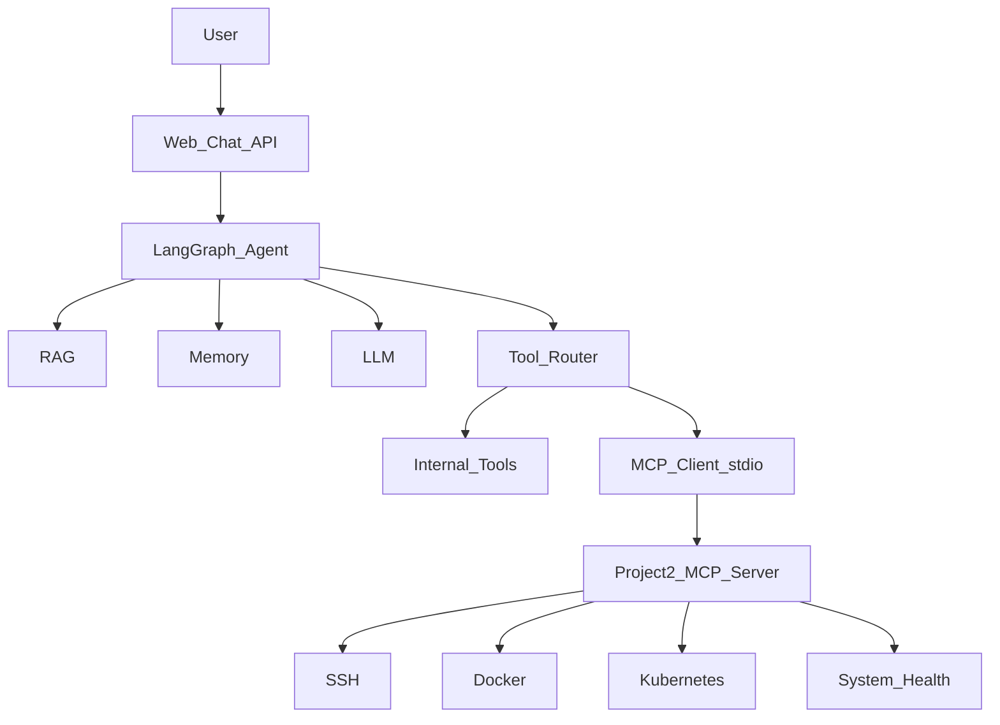

# MCP stdio 集成升级计划（项目1 ← 项目2）

## 架构决策（已锁定）

- **传输**：stdio（官方 MCP Client `spawn` 项目2进程），不改项目2、不复制其业务代码。
- **角色**：项目1 = Agent + MCP Client；项目2 = 独立 DevOps MCP Server。
- **兼容**：`ENABLE_MCP=false` 时仅用内置 18 工具，行为与 v1.3.0 一致。
- **版本定位**：对外升级为 **v2.0.0（MCP-powered）**，代码兼容开关可回退。



## 阶段 0：审计文档（只写文档，不动业务）

在项目1 `docs/` 落地两份审计（基于已完成调研）：

- [`docs/PROJECT1_MCP_INTEGRATION_AUDIT.md`](docs/PROJECT1_MCP_INTEGRATION_AUDIT.md)
  - Agent 流程：`START → agent → tools → agent → END`（[`app/agent/graph.py`](app/agent/graph.py)）
  - 工具注册：[`app/tools/registry.py`](app/tools/registry.py) 惰性加载 18 个 `@tool`
  - 关键接入点：`get_tool_schemas()` / `get_tool()` / `tools_node.invoke`
  - 风险：[`app/agent/agent.py`](app/agent/agent.py) 启动时闭包缓存 schema；[`app/main.py`](app/main.py) 图单例
- [`docs/PROJECT2_MCP_SERVER_AUDIT.md`](docs/PROJECT2_MCP_SERVER_AUDIT.md)
  - 路径：`d:\代码项目\AI Agent项目\项目2：Enterprise DevOps MCP Server`
  - FastMCP + `mcp.run(show_banner=False)`，17 工具，stdio only
  - 启动：`python -m app.server` 或 `scripts/run_devops_mcp.py`

## 阶段 1：新增 MCP Client 模块

新建：

```
app/mcp/
  __init__.py
  config.py      # 读取 ENABLE_MCP / COMMAND / ARGS / CWD / TIMEOUT
  client.py      # stdio 会话：connect / list_tools / call_tool / close
  manager.py     # 生命周期（startup/shutdown）、单连接、失败降级
  tools.py       # MCP Tool → LangChain 兼容包装（name/description/invoke/args_schema）
```

实现要点：

- 依赖：在 [`requirements.txt`](requirements.txt) 增加官方 `mcp` SDK（Client Session + StdioServerParameters）。
- [`client.py`](app/mcp/client.py)：用 `stdio_client` 启动项目2，`session.initialize()` → `list_tools()` → `call_tool(name, arguments)`。
- [`manager.py`](app/mcp/manager.py)：`ENABLE_MCP=true` 时在 FastAPI lifespan 连接；失败时打日志并降级到内置工具（不阻断启动）。
- [`tools.py`](app/mcp/tools.py)：将 MCP schema 转成 OpenAI function schema，并包装为可 `.invoke(args)` 的对象，供现有 `tools_node` 使用。
- 命名策略：MCP 工具保留原名（如 `k8s_get_pods`）；与内置重名时 **MCP 优先**（仅当 ENABLE_MCP=true），内置仍可通过未覆盖名使用。

配置（写入 [`app/config.py`](app/config.py) + [`.env.example`](.env.example)）：

```
ENABLE_MCP=true
MCP_SERVER_COMMAND=python
MCP_SERVER_ARGS=-m,app.server
MCP_SERVER_CWD=<项目2绝对路径>
MCP_TIMEOUT=30
```

（不采用 `MCP_SERVER_URL`；与 stdio 决策一致。）

## 阶段 2：Agent / Registry 改造（最小侵入）

| 文件 | 改动 |
|------|------|
| [`app/tools/registry.py`](app/tools/registry.py) | 增加 `get_merged_tools()` / `get_tool_schemas()` 合并 internal+MCP；`get_tool(name)` 先查 MCP 再查 internal |
| [`app/agent/agent.py`](app/agent/agent.py) | **去掉闭包缓存**：每次 `agent_node` 内调用 `get_tool_schemas()`，使动态工具可见 |
| [`app/agent/tools_node.py`](app/agent/tools_node.py) | 保持 `get_tool().invoke`；若 MCP 包装统一提供 `.invoke`，可几乎不改 |
| [`app/agent/prompts.py`](app/agent/prompts.py) | 工具清单改为“以当前 schema 为准”，避免硬编码过时列表 |
| [`app/main.py`](app/main.py) | lifespan：`mcp_manager.start()` / `stop()`；`/api/agent/stats` 报告 internal/mcp 数量与 MCP 连接状态 |
| 内置 `app/tools/*.py` | **不删除、不迁移业务逻辑到项目2** |

Tool Router 逻辑（概念）：

```
Agent → get_tool(name)
          ├─ MCP 已启用且存在 → MCP Client.call_tool
          └─ 否则 → Internal LangChain Tool.invoke
```

## 阶段 3：测试

新增 [`tests/test_mcp_integration.py`](tests/test_mcp_integration.py)：

1. **连接**：mock 或真实 spawn（可用 `MCP_SERVER_CWD`）；断言 `list_tools` 非空。
2. **Tool 调用**：对只读工具（如 `get_cpu_usage` / `docker_list` / `k8s_get_pods`）做调用；无 Docker/K8s 环境时断言结构化错误而非崩溃。
3. **开关兼容**：`ENABLE_MCP=false` 时 schema 仅内置，行为与改造前一致。
4. **Agent 路径**：mock MCP `call_tool`，输入“检查生产环境订单服务异常”，断言 trace 中出现 MCP 工具名，且仍可走 RAG 注入路径。

尽量用 pytest + mock session，避免 CI 强依赖项目2路径；本地可设 env 跑真实集成。

## 阶段 4：Demo / README / 验收

- [`docs/demo/mcp-demo.md`](docs/demo/mcp-demo.md)：Demo1 订单服务异常（kubectl → logs → RAG → 报告）完整话术与期望工具链。
- 更新 [`README.md`](README.md)：定位改为 MCP-powered AI DevOps Agent Platform；补充架构图、启用 MCP 步骤、项目2路径说明。
- [`docs/MCP_INTEGRATION_ACCEPTANCE_REPORT.md`](docs/MCP_INTEGRATION_ACCEPTANCE_REPORT.md)：修改文件列表、新架构图、调用流程、工具列表、测试结果、Demo、评分变化（相对 85 分上调 MCP 维度）。

## 明确不做

- 不复制项目2工具实现进项目1。
- 不给项目2加 HTTP/SSE（本阶段）。
- 不删除内置工具。
- 不重构 RAG/Memory 核心（仅确保 MCP 开启时仍注入上下文）。

## 关键风险与缓解

| 风险 | 缓解 |
|------|------|
| schema 启动缓存导致 MCP 工具对 LLM 不可见 | `agent_node` 每次刷新 schema |
| Windows 路径 / 项目2 CWD 配置错误 | `.env.example` 写清；manager 启动失败降级 |
| 工具名冲突 | ENABLE_MCP 时 MCP 覆盖同名；文档列出映射表 |
| 同步 FastAPI + 异步 MCP SDK | client 内用专用线程/事件循环桥接 `call_tool`，避免阻塞策略不当 |

## 实施顺序

1. 写两份审计文档  
2. `app/mcp/*` + config + requirements  
3. registry / agent / main 接线  
4. 测试 + Demo + README + 验收报告  
5. 本地：`ENABLE_MCP=true` 真实拉起项目2做一次端到端冒烟
