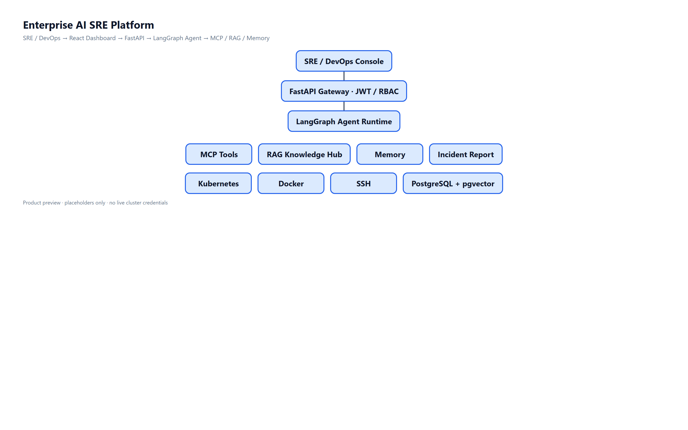
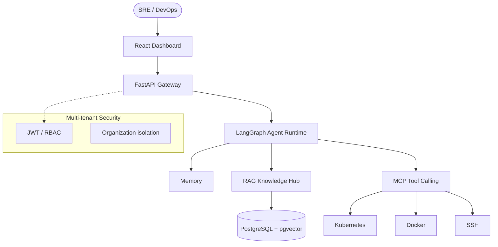
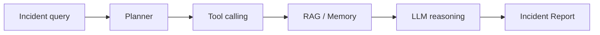
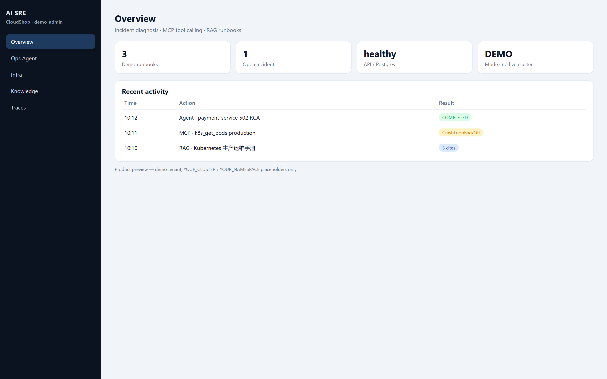
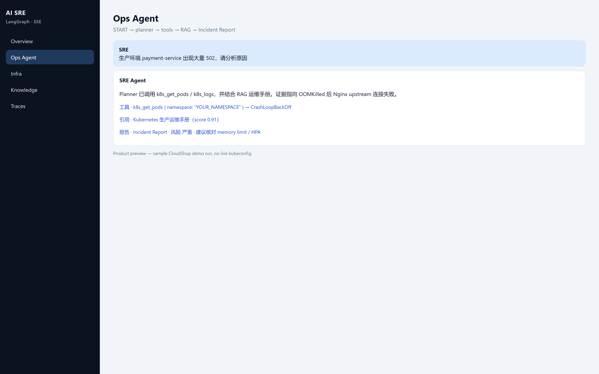
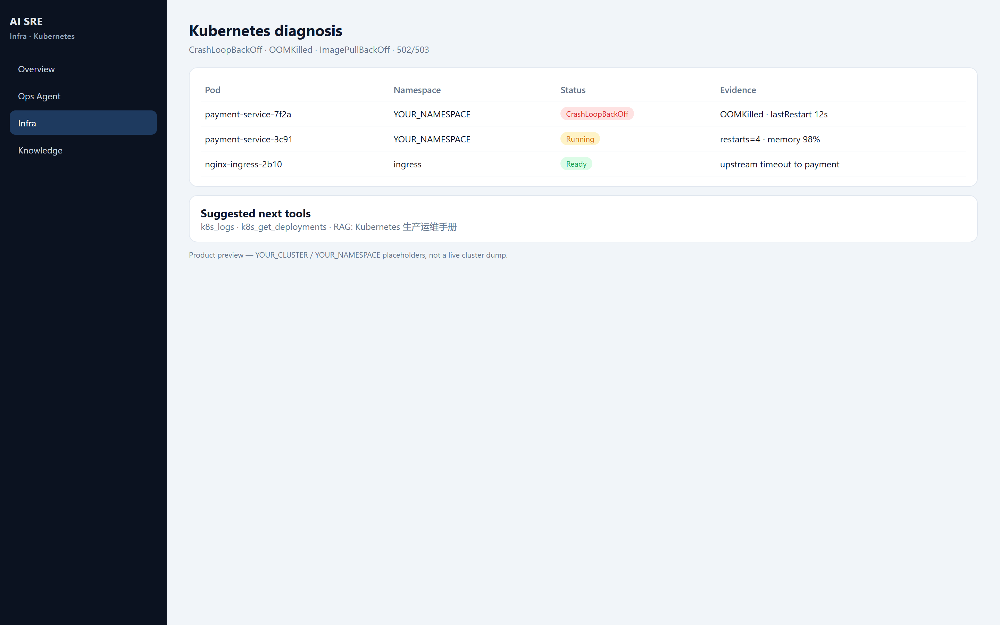

<div align="center">

# Enterprise AI DevOps Platform

**Enterprise AI SRE Agent for autonomous incident diagnosis, MCP tool calling, and RAG-backed runbooks.**

面向企业 SRE / DevOps 的 AI 自主运维平台：自然语言描述故障，Agent 规划工具链、检索知识库、输出结构化 Incident Report。

[English](README_EN.md) · [Architecture](docs/ARCHITECTURE.md) · [Security](SECURITY.md) · [Contributing](CONTRIBUTING.md)

[]()
[]()
[]()
[]()
[]()
[](LICENSE)

</div>

---

## Positioning

This is **not** a chatbot demo. It is an enterprise operations product:

| Capability | What it does |
|------------|----------------|
| AI Agent | LangGraph planner + reasoning over live infra evidence |
| MCP Tool Calling | Dynamic discovery of Kubernetes / Docker / SSH tools |
| RAG Knowledge Hub | Multi-tenant runbooks, SOP retrieval, Feishu sync |
| Memory | Conversation + working memory for multi-step RCA |
| Multi-tenant | JWT, RBAC, organization isolation |
| Cloud native | Docker Compose; Kubernetes-oriented diagnosis |

Repository: [enterprise-ai-sre-platform](https://github.com/zhifengjin050-arch/enterprise-ai-sre-platform)

---

## Features

- **AI Agent runtime** — `START → agent → tools → agent → END`
- **MCP tool ecosystem** — System / Docker / Kubernetes / SSH without rewriting the orchestrator
- **RAG Knowledge Hub** — pgvector search scoped by `organization_id`
- **Kubernetes diagnosis** — CrashLoopBackOff, OOMKilled, ImagePullBackOff, 502/503
- **Agent Trace + SSE** — every tool call timed and streamed to the console
- **Enterprise automation** — incident reports, runbook citation, multi-tenant RBAC

---

## Architecture





### Agent workflow



---

## Use cases

| Scenario | Example |
|----------|---------|
| Production 502 | `payment-service is returning 502, find the root cause` |
| Pod crash | `CrashLoopBackOff in production namespace` |
| Capacity | `database connection pool is exhausted` |
| Fleet check | `inspect CPU and disk on managed hosts` |
| SOP lookup | `standard steps for OOMKilled` |

---

## Tech Stack

| Layer | Stack |
|-------|--------|
| Agent | LangGraph · LangChain · DeepSeek (OpenAI-compatible) |
| API | Python 3.12 · FastAPI · SSE |
| Knowledge | RAG · pgvector · Feishu connector |
| Tools | MCP · kubectl · Docker · SSH |
| Frontend | React 18 · TypeScript · Vite · Tailwind |
| Data | PostgreSQL 16 |
| Ops | Prometheus · Grafana · Docker Compose |

---

## Screenshots

| Dashboard | Agent interaction |
|-----------|-------------------|
|  |  |

| Kubernetes | Architecture |
|------------|--------------|
|  |  |

Product preview assets for GitHub showcase (1440-class widescreen). Live console routes: `/overview`, `/ops`, `/infra`, `/knowledge`, `/traces`.

---

## Quick Start

```bash
git clone https://github.com/zhifengjin050-arch/enterprise-ai-sre-platform.git
cd enterprise-ai-sre-platform
cp .env.example .env
# set SILICONFLOW_API_KEY (or compatible LLM key)
./scripts/demo_start.sh          # Windows: .\scripts\demo_start.ps1
```

Open http://localhost ，账号 `demo_admin` / `Demo@2026!`。详情见 [demo/README.md](demo/README.md)。

Local backend: `uvicorn app.main:app --reload --port 8000`  
Local frontend: `cd frontend && npm install && npm run dev`

---

## Deployment

| Mode | Entry |
|------|--------|
| Docker Compose | `docker compose up -d` |
| Kubernetes diagnosis | Agent tools against the target cluster |
| Config | `.env.example` — never commit real `.env` |

See [docs/DEPLOYMENT.md](docs/DEPLOYMENT.md).

---

## Roadmap

**v3.3.0 (current):** LangGraph Agent, MCP, RAG Hub, multi-tenant, Trace, SSE, Docker.

Later: multi-cloud intelligence, autonomous repair workflows, broader MCP catalog.

---

## License

[MIT](LICENSE)

[CONTRIBUTING.md](CONTRIBUTING.md) · [CODE_OF_CONDUCT.md](CODE_OF_CONDUCT.md) · [SECURITY.md](SECURITY.md) · [CHANGELOG.md](CHANGELOG.md)
