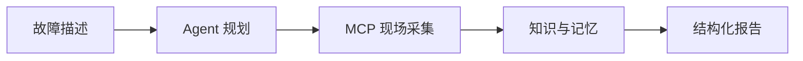
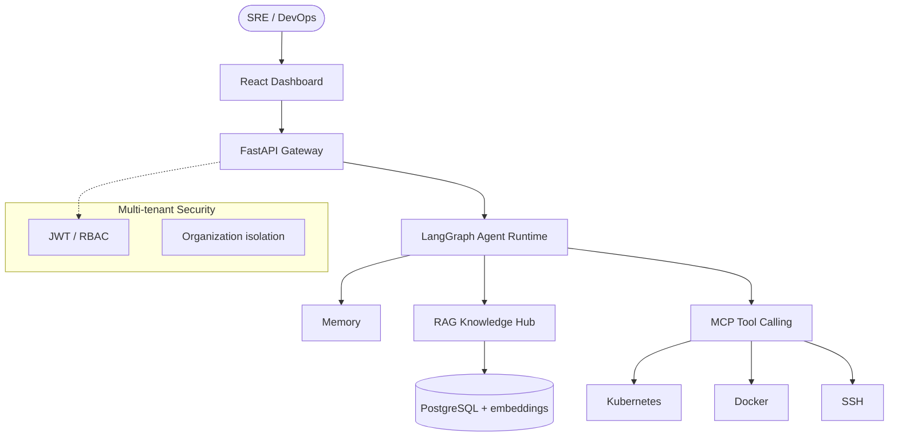
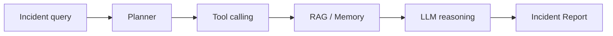

<picture><source media="(prefers-color-scheme: dark)" srcset="docs/showcase/hero-dark.svg"><source media="(prefers-color-scheme: light)" srcset="docs/showcase/hero-light.svg"></picture>

<div align="center">

# Enterprise AI DevOps Platform

**Enterprise AI SRE Agent for autonomous incident diagnosis, MCP tool calling, and RAG-backed runbooks.**

面向企业 SRE / DevOps 的 AI 自主运维平台：自然语言描述故障，Agent 规划工具链、检索知识库、输出结构化 Incident Report。

[English](README_EN.md) · [Architecture](docs/ARCHITECTURE.md) · [Security](SECURITY.md) · [Contributing](CONTRIBUTING.md)

[]()
[]()
[]()
[]()
[]()
[](LICENSE)

</div>

<!-- engineering-guide:start -->
<a id="-工程导读--从场景到实现"></a>
<h2><picture><source media="(prefers-color-scheme: dark)" srcset="docs/showcase/section-01-dark.svg"><source media="(prefers-color-scheme: light)" srcset="docs/showcase/section-01-light.svg"></picture></h2>


**以证据为中心的智能故障诊断**。将故障描述转成分步诊断，结合基础设施现场信息与知识库，输出可追问、可核查的故障报告。



- LangGraph 循环负责多步推理与工具调用；重点阅读每步如何结束、继续和处理错误。
- 现场信息与 Runbook 解决不同问题：前者描述当前状态，后者提供排查知识，报告应明确证据来源。
- SSE 面向执行进度展示，Trace 面向事后分析，两者共同支持诊断过程可见。

📖 **[阅读完整工程导读](docs/PROJECT_GUIDE.md)**：源码路径、最短运行路线、演示验收与当前边界。
<!-- engineering-guide:end -->


---

<a id="positioning"></a>
<h2><picture><source media="(prefers-color-scheme: dark)" srcset="docs/showcase/section-02-dark.svg"><source media="(prefers-color-scheme: light)" srcset="docs/showcase/section-02-light.svg"></picture></h2>


This is **not** a chatbot demo. It is an enterprise operations product:

| Capability | What it does |
|------------|----------------|
| AI Agent | LangGraph planner + reasoning over live infra evidence |
| MCP Tool Calling | Dynamic discovery of Kubernetes / Docker / SSH tools |
| RAG Knowledge Hub | Multi-tenant runbooks, SOP retrieval, Feishu sync |
| Memory | Conversation + working memory for multi-step RCA |
| Multi-tenant | JWT, RBAC, organization isolation |
| Cloud native | Docker Compose; Kubernetes-oriented diagnosis |

Repository: [enterprise-ai-sre-platform](https://github.com/zhifengjin050-arch/enterprise-ai-sre-platform)

---

<a id="demo"></a>
<h2><picture><source media="(prefers-color-scheme: dark)" srcset="docs/showcase/section-03-dark.svg"><source media="(prefers-color-scheme: light)" srcset="docs/showcase/section-03-light.svg"></picture></h2>


[](https://zhifengjin050-arch.github.io/enterprise-ai-sre-platform/)

点击封面在线播放（中文旁白 + 底部字幕）。GitHub 文件页无法内嵌 mp4，演示页托管在 GitHub Pages。

---

<a id="features"></a>
<h2><picture><source media="(prefers-color-scheme: dark)" srcset="docs/showcase/section-04-dark.svg"><source media="(prefers-color-scheme: light)" srcset="docs/showcase/section-04-light.svg"></picture></h2>


- **AI Agent runtime** — `START → agent → tools → agent → END`
- **MCP tool ecosystem** — System / Docker / Kubernetes / SSH without rewriting the orchestrator
- **RAG Knowledge Hub** — JSON embeddings + cosine search, scoped by `organization_id`
- **Kubernetes diagnosis** — CrashLoopBackOff, OOMKilled, ImagePullBackOff, 502/503
- **Agent Trace + SSE** — every tool call timed and streamed to the console
- **Enterprise automation** — incident reports, runbook citation, multi-tenant RBAC

---

<a id="architecture"></a>
<h2><picture><source media="(prefers-color-scheme: dark)" srcset="docs/showcase/section-05-dark.svg"><source media="(prefers-color-scheme: light)" srcset="docs/showcase/section-05-light.svg"></picture></h2>




### Agent workflow



---

<a id="use-cases"></a>
<h2><picture><source media="(prefers-color-scheme: dark)" srcset="docs/showcase/section-06-dark.svg"><source media="(prefers-color-scheme: light)" srcset="docs/showcase/section-06-light.svg"></picture></h2>


| Scenario | Example |
|----------|---------|
| Production 502 | `payment-service is returning 502, find the root cause` |
| Pod crash | `CrashLoopBackOff in production namespace` |
| Capacity | `database connection pool is exhausted` |
| Fleet check | `inspect CPU and disk on managed hosts` |
| SOP lookup | `standard steps for OOMKilled` |

---

<a id="tech-stack"></a>
<h2><picture><source media="(prefers-color-scheme: dark)" srcset="docs/showcase/section-07-dark.svg"><source media="(prefers-color-scheme: light)" srcset="docs/showcase/section-07-light.svg"></picture></h2>


| Layer | Stack |
|-------|--------|
| Agent | LangGraph · LangChain · DeepSeek (OpenAI-compatible) |
| API | Python 3.12 · FastAPI · SSE |
| Knowledge | RAG · cosine embeddings · Feishu connector |
| Tools | MCP · kubectl · Docker · SSH |
| Frontend | React 18 · TypeScript · Vite · Tailwind |
| Data | PostgreSQL 16 |
| Ops | Prometheus · Grafana · Docker Compose |

---

<a id="screenshots"></a>
<h2><picture><source media="(prefers-color-scheme: dark)" srcset="docs/showcase/section-08-dark.svg"><source media="(prefers-color-scheme: light)" srcset="docs/showcase/section-08-light.svg"></picture></h2>


| Dashboard | Agent interaction |
|-----------|-------------------|
|  |  |

| Kubernetes | Architecture |
|------------|--------------|
|  |  |

Product preview assets for GitHub showcase (1440-class widescreen). Live console routes: `/overview`, `/ops`, `/infra`, `/knowledge`, `/traces`.

---

<a id="quick-start"></a>
<h2><picture><source media="(prefers-color-scheme: dark)" srcset="docs/showcase/section-09-dark.svg"><source media="(prefers-color-scheme: light)" srcset="docs/showcase/section-09-light.svg"></picture></h2>


```bash
git clone https://github.com/zhifengjin050-arch/enterprise-ai-sre-platform.git
cd enterprise-ai-sre-platform
cp .env.example .env
# set SILICONFLOW_API_KEY (or compatible LLM key)
./scripts/demo_start.sh          # Windows: .\scripts\demo_start.ps1
```

Open http://localhost ，账号 `demo_admin` / `Demo@2026!`。详情见 [demo/README.md](demo/README.md)。

Local backend: `uvicorn app.main:app --reload --port 8000`  
Local frontend: `cd frontend && npm install && npm run dev`

---

<a id="deployment"></a>
<h2><picture><source media="(prefers-color-scheme: dark)" srcset="docs/showcase/section-10-dark.svg"><source media="(prefers-color-scheme: light)" srcset="docs/showcase/section-10-light.svg"></picture></h2>


| Mode | Entry |
|------|--------|
| Docker Compose | `docker compose up -d` |
| Kubernetes diagnosis | Agent tools against the target cluster |
| Config | `.env.example` — never commit real `.env` |

See [docs/DEPLOYMENT.md](docs/DEPLOYMENT.md).

---

<a id="roadmap"></a>
<h2><picture><source media="(prefers-color-scheme: dark)" srcset="docs/showcase/section-11-dark.svg"><source media="(prefers-color-scheme: light)" srcset="docs/showcase/section-11-light.svg"></picture></h2>


**v3.3.0 (current):** LangGraph Agent, MCP, RAG Hub, multi-tenant, Trace, SSE, Docker.

Later: multi-cloud intelligence, autonomous repair workflows, broader MCP catalog.

---

<a id="license"></a>
<h2><picture><source media="(prefers-color-scheme: dark)" srcset="docs/showcase/section-12-dark.svg"><source media="(prefers-color-scheme: light)" srcset="docs/showcase/section-12-light.svg"></picture></h2>


[MIT](LICENSE)

[CONTRIBUTING.md](CONTRIBUTING.md) · [CODE_OF_CONDUCT.md](CODE_OF_CONDUCT.md) · [SECURITY.md](SECURITY.md) · [CHANGELOG.md](CHANGELOG.md)
