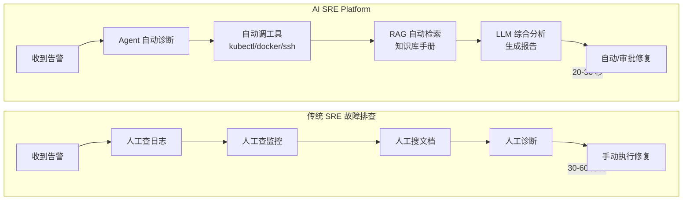
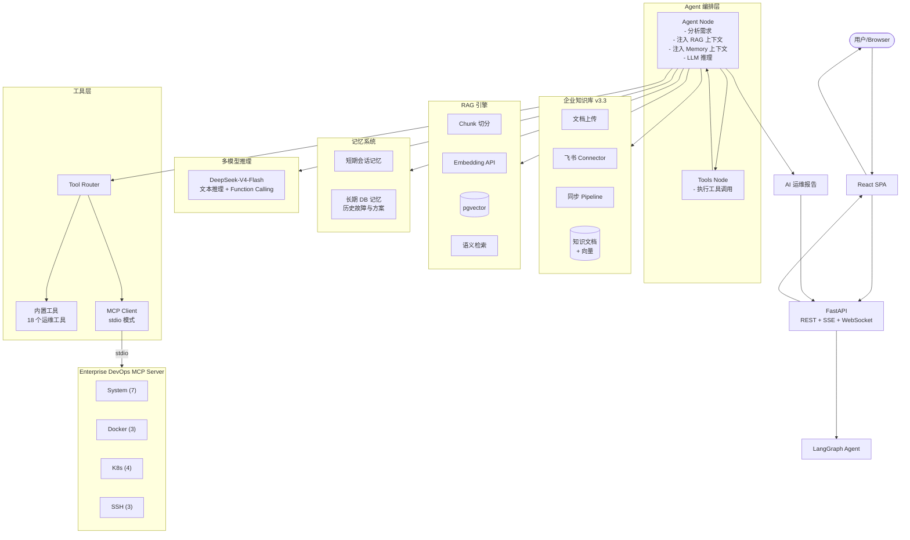
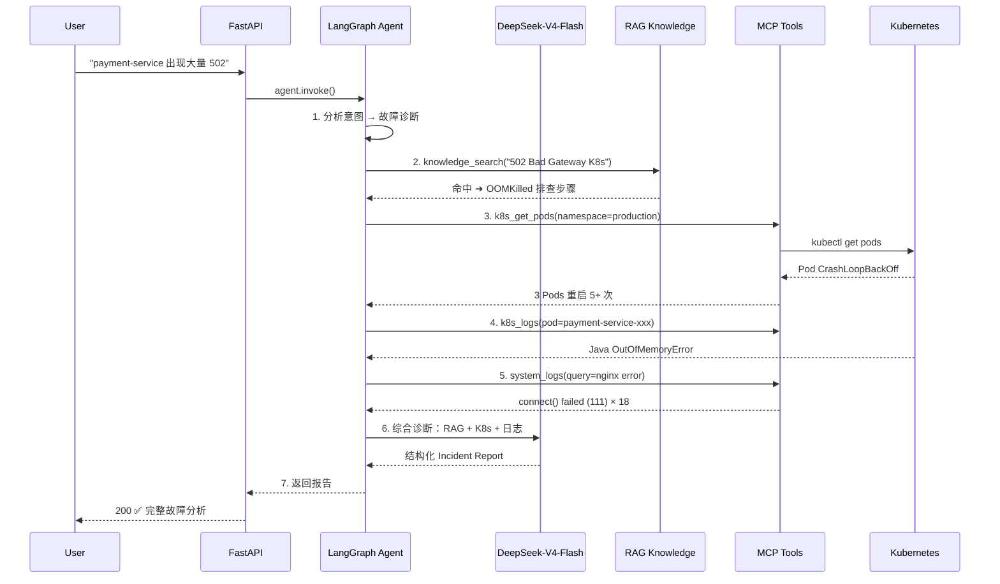

# Enterprise AI SRE Autonomous Operations Platform

<p align="center">
  <b>基于 LangGraph + MCP + RAG 的企业级 AI SRE Agent 平台</b><br>
  将自然语言转化为基础设施操作 — 智能运维、故障诊断、知识检索、自动修复一体化。
</p>

<p align="center">
  
  
  
  
  
  
  
  
  
  
  
  
  
  
</p>

<p align="center">
  <a href="#-项目介绍">项目介绍</a> •
  <a href="#-features">Features</a> •
  <a href="#-architecture">Architecture</a> •
  <a href="#-demo-场景演示">Demo</a> •
  <a href="#-快速开始">快速开始</a> •
  <a href="#-截图预览">Screenshots</a> •
  <a href="#-roadmap">Roadmap</a>
</p>

---

## 📖 项目介绍

**Enterprise AI SRE Autonomous Operations Platform** 是一个面向企业的 AI 驱动智能运维平台，深度融合 **大语言模型推理**、**MCP 协议扩展**、**RAG 企业知识库** 与 **DevOps 工具链**，让 SRE / 运维人员通过自然语言即可完成复杂的运维操作。

---

## 🤔 Why AI SRE?

### 传统运维的痛点



| 对比维度 | 传统 SRE 运维 | AI SRE Platform |
|---------|-------------|----------------|
| **故障响应** | 人员收到告警 → 登录跳板机 → 手动查日志 → 30min+ | Agent 秒级自动诊断，20s 输出根因分析报告 |
| **工具操作** | kubectl / SSH / Docker 命令繁多，容易出错 | 自然语言驱动，Agent 自动规划并执行工具链 |
| **知识管理** | Wiki / 文档 / 聊天记录散落各处，新人无从下手 | RAG 知识库统一管理企业 SOP，Agent 自动检索引用 |
| **工具扩展** | 接入新工具需改 Agent 代码、重写工具调用逻辑 | MCP 协议标准化接入，新工具自动发现无需改代码 |
| **可观测性** | 日志/指标/Trace 分散在不同系统 | Agent Trace 全链路追踪 + Prometheus + Grafana 一体化 |
| **多租户安全** | 缺乏完善权限体系 | JWT + RBAC + Organization 多租户隔离 |

### 适用场景

| 场景 | 传统方式 | AI SRE 方式 | 时间缩短 |
|------|---------|------------|---------|
| K8s Pod CrashLoopBackOff 诊断 | `kubectl` 手动排查，逐项检查 | Agent 自动调工具 + 知识库检索 | 30min → 20s |
| 服务器健康巡检 | 登录每台服务器执行命令 | 自然语言一键巡检全部服务器 | 15min → 10s |
| Nginx 502 故障定位 | 手动查日志、追踪 upstream | Agent 关联分析 K8s + 日志 + RAG | 20min → 15s |
| 数据库连接池排查 | 逐项检查配置、日志、监控 | Agent 综合分析 + 给出优化建议 | 25min → 15s |
| 运维知识查询 | 搜索 Wiki / 问同事 | 自然语言提问，RAG 精准命中 | 10min → 3s |

### 📋 项目规模

| 指标 | 数值 |
|------|:----:|
| 📁 后端 Python 文件 | **50+** 个（Agent / 工具 / API / RAG / 知识库 / MCP / 监控 / 记忆 / Trace） |
| 🎨 前端页面 | **8** 个（Overview / Copilot / Infra / Incidents / Knowledge / Traces / Monitor / Login） |
| 🧪 测试用例 | **280+**（单元 + 集成 + 场景 + 安全） |
| 🔧 MCP 工具 | **17** 个（System / Docker / K8s / SSH） |
| 🎯 内置工具 | **18** 个（服务器 / Docker / K8s / 日志 / 知识搜索） |
| 📄 项目文档 | **20+** 份（架构 / Demo / 部署 / 安全 / API） |
| 🏆 当前版本 | **v3.3.0 Enterprise Knowledge Hub** |

---

## ✨ Features

<p align="center">
  
  
  
  
  
  
  
  
</p>

### 🤖 AI Agent 自然语言运维

通过 LangGraph 构建的有状态 Agent，理解自然语言并自动编排多步骤工具调用链。

```
用户输入 → Agent Planner → RAG 上下文注入 → Memory 注入
  → LLM 推理 (Tool Calling) → 并行工具调用
  → 第二轮推理 → 结构化报告输出
```

**示例：** `"生产环境 payment-service 出现大量 502，请分析原因"`

Agent 自动：
1. 调用 `kubectl_get_pods` → 发现 Pod CrashLoopBackOff
2. 调用 `kubectl_logs` → 发现 OOMKilled + 数据库连接池耗尽
3. RAG 检索 `k8s_troubleshooting.md` → 命中 OOMKilled 排查步骤
4. 生成完整 Incident Report（根因 / 影响 / 修复方案 / 优化建议）

### 🔌 MCP Tool Calling

基于 MCP（Model Context Protocol）协议动态发现并调用 17 个企业运维工具：

| 模块 | 工具数 | 功能 |
|------|:------:|------|
| 🖥️ **System** | 7 | 服务器健康 / CPU / 内存 / 磁盘 / 审计日志 / 进程 |
| 🐳 **Docker** | 3 | 容器列表 / 日志 / 重启 |
| ☸️ **Kubernetes** | 4 | Pod 状态 / 部署 / 服务 / 日志 |
| 🔗 **SSH** | 3 | 远程连接 / 命令执行 / 文件上传 |

### 📚 企业知识库 RAG

支持文档上传、语义检索及飞书知识库同步，Agent 自动注入相关上下文：

- **文档上传**：Markdown / 文本 → Chunk 切分 → Embedding → pgvector
- **语义检索**：Agent 自动调用 `knowledge_search` 工具 + 引用原文
- **飞书集成**：连接器拉取飞书知识库 Wiki，定时同步
- **多租户隔离**：Organization 级别文档隔离，保障数据安全

### ☸️ Kubernetes 运维诊断

覆盖完整 K8s 故障排查场景：

| 故障类型 | Agent 诊断能力 |
|---------|---------------|
| CrashLoopBackOff | 检查配置错误、依赖服务、资源限制 |
| OOMKilled | Pod 事件分析、resource limits 建议 |
| ImagePullBackOff | 镜像仓库认证、名称检查 |
| Pod Pending | 节点资源、调度策略分析 |
| 502/503 服务不可用 | Endpoint 检查、Nginx 日志关联分析 |

### 🔐 多租户权限隔离

| 角色 | 权限 | 适用 |
|------|------|------|
| **Admin** | 全部权限：创建组织 / 管理成员 / 配置知识源 | 平台管理员 |
| **DevOps** | 运维操作：Chat、K8s、Docker、知识检索 | 运维工程师 |
| **Viewer** | 只读：查看面板、已授权的知识文档 | 只读用户 |

### 📊 Agent Trace 可观测

- 完整 Agent 执行链路记录
- 每一步工具调用的输入 / 输出 / 耗时
- WebSocket 实时推送推理轨迹
- 前端 Trace 面板：瀑布时间线可视化

### 🔄 SSE 实时响应

- SSE（Server-Sent Events）流式输出 Agent 推理过程
- 实时显示工具调用进度与结果
- 前端 Markdown 渲染 + 代码高亮

---

## 🏗️ Architecture

### 整体架构图



### 核心调用链（故障诊断场景）



### 项目结构

```
enterprise-ai-sre-platform/
│
├── app/                          # Python 后端 (50+ 文件)
│   ├── main.py                   # FastAPI 入口 + 全部 API 路由
│   ├── agent/                    # LangGraph Agent 引擎
│   ├── tools/                    # 内置运维工具 (18 个)
│   ├── mcp/                      # MCP Client 模块
│   ├── llm/                      # LLM 客户端 (DeepSeek)
│   ├── rag/                      # RAG 知识库引擎
│   ├── knowledge/                # 企业知识库 (v3.3)
│   │   ├── provider.py           # 统一文档提供者
│   │   ├── pipeline.py           # 同步 Pipeline
│   │   ├── access.py             # RBAC 访问控制
│   │   ├── crypto.py             # 凭据加密 (Fernet)
│   │   └── connectors/           # 飞书等外部连接器
│   ├── memory/                   # 记忆模块
│   ├── streaming/                # SSE 流式输出
│   ├── trace/                    # Agent Trace
│   ├── auth/                     # JWT + RBAC
│   ├── database/                 # SQLAlchemy + Alembic
│   └── api/                      # API 路由模块
│
├── frontend/                     # React 18 + TypeScript SPA
│   ├── src/
│   │   ├── features/             # Overview / Copilot / Infra / Incidents / Knowledge / Traces / Monitor
│   │   ├── ui/                   # Design System
│   │   └── router/               # 前端路由
│   ├── nginx.conf
│   └── Dockerfile
│
├── demo/                         # Demo 数据 (v3.3 新增)
│   ├── incidents/                # 故障场景定义
│   ├── logs/                     # 示例日志数据
│   ├── knowledge/                # 知识库文档 (可直接导入)
│   └── import_demo_data.py       # 一键导入脚本
│
├── tests/                        # 280+ 测试用例
├── docs/                         # 完整文档目录
├── scripts/                      # 工具脚本
├── prometheus/                   # Prometheus 配置
├── grafana/                      # Grafana 仪表盘
├── alembic/                      # 数据库迁移
│
├── docker-compose.yml            # 开发环境编排
├── docker-compose.prod.yml       # 生产环境编排
├── .env.example                  # 环境变量模板
├── requirements.txt              # Python 依赖
└── README.md                     # 本文件
```

---

## 🎬 Demo 场景演示

> **前置条件**：Docker Compose 启动或本地 uvicorn 运行。

### 场景：Kubernetes 502 故障排查

这是一个完整的 SRE 故障排查 Demo，旨在 **5 分钟内展现平台核心价值**。

**用户输入：**

```
生产环境 payment-service 出现大量 502，请分析原因
```

**Agent 自动执行链路：**

| 步骤 | Agent 操作 | 工具 | 发现 |
|------|-----------|------|------|
| 1️⃣ | 查询 Pod 状态 | `kubectl_get_pods` | 3 个 Pod 反复 CrashLoopBackOff |
| 2️⃣ | 查看 Pod 事件 | `kubectl_describe_pod` | Last State: OOMKilled (exit 137) |
| 3️⃣ | 查看应用日志 | `kubectl_logs` | Java OutOfMemoryError + 连接池耗尽 |
| 4️⃣ | 检索知识库 | `knowledge_search` | 命中 K8s 故障手册 OOMKilled 章节 |
| 5️⃣ | 检查 Nginx 日志 | `system_logs` | 18 条 `connect() failed (111)` |
| 6️⃣ | 综合 LLM 推理 | DeepSeek-V4-Flash | 生成结构化故障报告 |

**输出：**

```markdown
## Incident Report

### 问题摘要
生产环境 payment-service 从 09:25 开始出现大规模 502 Bad Gateway，错误率 23%。

### 影响范围
- 支付接口完全不可用
- 涉及 3 条业务线，预计影响 12,000+ 在线用户

### 根因分析 (RCA)
1. **直接原因**：Pod 内存溢出 (OOMKilled) → 容器反复重启
2. **诱因**：数据库连接池耗尽 → 请求阻塞 → 内存泄漏
3. **放大效应**：Nginx upstream 全部标记为不可用

### 诊断证据
| 来源 | 关键发现 |
|------|---------|
| K8s Pod 状态 | payment-service-xxx: CrashLoopBackOff (重启 5 次) |
| Pod 事件 | OOMKilled: exit code 137 |
| 应用日志 | java.lang.OutOfMemoryError: Java heap space |
| 连接池 | 连接泄漏检测: 12 个未归还连接 |
| Nginx 日志 | upstream 111 Connection refused × 18 |
| RAG 知识库 | 引用: K8s 故障排查手册 §OOMKilled |

### 建议处理方案
1. **立即恢复**：kubectl scale deployment/payment-service --replicas=5
2. **资源配置**：将 memory limits 从 512Mi 提升至 1Gi
3. **连接池修复**：增加 HikariCP max-pool-size + 开启 leak-detection
4. **自动伸缩**：配置 HPA 基于 CPU/内存指标

### 风险等级
🔴 **严重 (Critical)** — 需立即处理

### 后续优化建议
- 为 payment-service 添加 PodDisruptionBudget
- 配置 ReadinessProbe 避免流量进入异常 Pod
- 实现熔断降级：支付网关不可用时快速失败
- 增加 JVM Heap Dump 自动采集
```

### 快速体验 Demo

```bash
# 1. 启动项目
docker compose up -d

# 2. 浏览器访问 http://localhost
# 3. 注册账号并登录
# 4. 导入 Demo 知识库文档
python demo/import_demo_data.py

# 5. 打开 /ops 页面，输入:
#    "生产环境 payment-service 出现大量 502，请分析原因"
# 6. 观察 Agent 自动诊断全过程
```

---

## 🚀 快速开始

### 前置要求

- **Python 3.12+**
- **API Key**：注册 [SiliconFlow](https://cloud.siliconflow.cn) 获取 `SILICONFLOW_API_KEY`
- **Docker**（可选，用于容器化部署）

### 方式一：本地运行（5 分钟）

```bash
# 1. 克隆项目
git clone https://github.com/your-org/enterprise-ai-sre-platform.git
cd enterprise-ai-sre-platform

# 2. 安装依赖
pip install -r requirements.txt

# 3. 配置环境变量
cp .env.example .env
# 编辑 .env，填入 SILICONFLOW_API_KEY

# 4. 初始化数据库
alembic upgrade head

# 5. 启动服务
python run.py
# 或 uvicorn app.main:app --host 127.0.0.1 --port 8000

# 6. 打开 http://localhost:8000 → 注册 → 开始体验
```

### 方式二：Docker 一键部署

```bash
# 启动全部服务（Backend + Frontend + PostgreSQL + Prometheus + Grafana）
docker compose up -d

# 访问 http://localhost → 注册 → 开始体验
```

### 控制台路由

| 路由 | 页面 | 说明 |
|------|------|------|
| `/overview` | Executive Dashboard | 健康分 / KPI / 趋势 |
| `/ops` | AI Operations Copilot | 三栏对话 + SSE Live Execution |
| `/infra` | Infrastructure | Hosts / Docker / Kubernetes |
| `/incidents` | Incident Management | 告警 + 失败 Run + 审批 |
| `/knowledge` | Knowledge Center | RAG 企业知识库 + Hub (v3.3) |
| `/traces` | Agent Trace Center | Run 列表 + 瀑布时间线 |
| `/monitor` | Monitoring Center | 实时指标 + Grafana iframe |

> 旧路径 `/dashboard` `/chat` `/servers` `/kubernetes` `/monitoring` `/trace` 自动跳转到新路径。

---

## 📸 截图预览

> 截图存放于 [`docs/images/`](docs/images/) 目录，目前为占位描述。部署后可自行截图替换。

| 页面 | 说明 |
|------|------|
| 🔐 **登录 / 注册** | 双栏品牌页 + JWT 认证 |
| 📊 **Overview 仪表盘** | 系统健康评分、风险统计、Agent 执行趋势 |
| 💬 **AI Copilot** | SSE 实时对话 + Markdown 报告 + Live Execution 面板 |
| 🚨 **Incidents** | 告警列表、故障 RCA、自动修复审批 |
| 🖥️ **Infrastructure** | 服务器列表、Docker 容器、K8s Pod 状态 |
| 📚 **Knowledge Hub** | 企业知识库：文档管理、飞书同步、语义搜索 (v3.3) |
| 📋 **Trace Center** | Agent 执行链路可视化和瀑布时间线 |
| 📈 **Monitor** | Prometheus + Grafana 嵌入式监控面板 |

---

## 🗺️ Roadmap

### ✅ v3.3.0 — Enterprise Knowledge Hub（当前版本）

- [x] LangGraph Agent 引擎
- [x] 17 个 MCP 运维工具
- [x] RAG 企业知识库（上传 + 语义检索）
- [x] 企业知识 Hub（多租户、RBAC、飞书连接器、同步 Pipeline）
- [x] Agent Trace 全链路追踪
- [x] SSE / WebSocket 实时流式响应
- [x] JWT + RBAC 多租户安全体系
- [x] Auto Repair 自动修复审批工作流
- [x] Docker Compose 一键部署
- [x] Prometheus + Grafana 可观测性
- [x] Demo 数据包 + 一键导入

### 🔜 v3.4 — Enterprise AI SRE Autonomous Operations（规划中）

> 以下为路线图规划，尚未实现。

- **Cloud Infrastructure Intelligence**：接入阿里云 / 腾讯云 / AWS 云资源管理
- **Autonomous Repair Workflow**：端到端自动修复流水线（检测 → 分析 → 计划 → 审批 → 执行 → 验证 → 回滚）
- **MCP Ecosystem**：企业工具扩展中心，支持第三方 MCP Server 动态注册
- **AI 根因分析引擎**：多维度指标关联分析
- **SLA/SLO 管理**：服务等级目标追踪与告警

---

## 🛠️ 技术栈

| 层次 | 技术 | 版本 | 用途 |
|------|------|:----:|------|
| 🎯 **AI Agent 框架** | LangGraph + LangChain | 1.2+ / 0.3+ | Agent 工作流编排 |
| 🔌 **MCP 协议** | 官方 `mcp` SDK (stdio Client) | 1.0+ | 标准工具发现与调用 |
| 🧠 **LLM 推理** | DeepSeek-V4-Flash | — | 文本推理 + Function Calling |
| 🌐 **LLM 供应商** | SiliconFlow 统一 API | — | 多模型统一接入 |
| ⚡ **后端框架** | FastAPI + Uvicorn | 0.115+ / 0.32+ | 高性能异步 Web |
| 🗄️ **数据库** | SQLAlchemy + Alembic + PostgreSQL 16 | 2.0+ / 1.13+ | ORM + 迁移 |
| 🎨 **前端** | React 18 + TypeScript + Vite + TailwindCSS | 18.3 | 企业级 SPA |
| 🐳 **容器编排** | Docker Compose（开发/生产/演示） | 29+ | 一键部署 |
| ☸️ **Kubernetes** | kubectl (JSON 输出) | 1.34+ | 集群管理与诊断 |
| 📈 **监控** | Prometheus 2.53 + Grafana 11.1 | — | 指标采集与可视化 |
| 🔐 **安全** | JWT + bcrypt + RBAC | — | 认证 / 授权 / 多租户 |

---

## 🔐 安全与多租户

| 层面 | 防护措施 |
|------|---------|
| 🔑 **认证** | JWT (HS256) + bcrypt；生产环境拒绝弱密钥 |
| 👤 **授权** | 多租户 RBAC：Organization + Admin / DevOps / Viewer |
| 🛡️ **API 安全** | Pydantic 校验 + Rate Limiting |
| 📋 **工具安全** | MCP Tool Metadata：risk_level / permission / audit |
| 🔧 **自动修复** | dangerous 操作需审批，禁止删库删文件 |
| 🔒 **密钥保护** | `.env` gitignore + 日志 SecretFilter 脱敏 |
| 🧪 **安全扫描** | `python scripts/security_check.py` |

---

## 📄 License

本项目采用 **MIT License** 开源，欢迎 Fork、Star、贡献代码。

```
MIT License
Copyright (c) 2026 Enterprise AI SRE Platform
```

---

## 📬 联系与交流

| 渠道 | 链接 |
|------|------|
| ⭐ **GitHub** | https://github.com/your-org/enterprise-ai-sre-platform |
| 🐛 **提交 Issue** | https://github.com/your-org/enterprise-ai-sre-platform/issues |
| 📖 **项目文档** | `docs/` 目录 |
| 💬 **技术交流** | GitHub Discussions |

---

<p align="center">
  <b>Enterprise AI SRE Autonomous Operations Platform v3.3.0</b><br>
  <sub>Enterprise Knowledge Hub · Multi-Tenant RAG · MCP Tool Ecosystem · AI Agent</sub>
</p>

<p align="center">
  <a href="#enterprise-ai-sre-autonomous-operations-platform">⬆ 返回顶部</a>
</p>