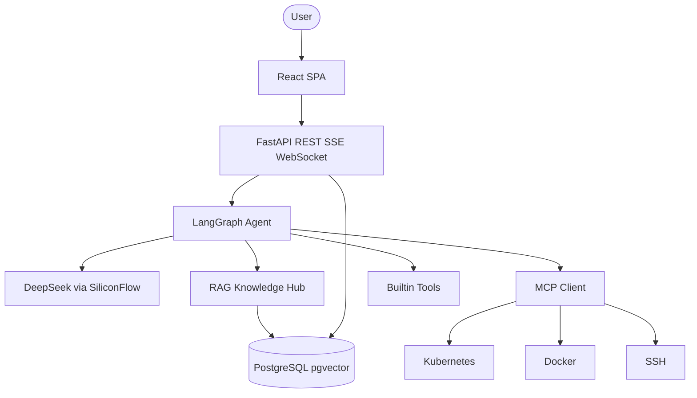

# Enterprise AI SRE Autonomous Operations Platform

<p align="center">
  
</p>

<p align="center">
  <b>Enterprise AI SRE Autonomous Operations Platform</b><br>
  An AI-powered SRE Agent platform built with LangGraph, MCP and RAG for autonomous infrastructure diagnosis.
</p>

<p align="center">
  <a href="README.md">简体中文</a> · <a href="README_EN.md">English</a>
</p>

<p align="center">
  
  
  
  
  
  
  
  
  
</p>

<p align="center">
  <a href="#项目简介">简介</a> •
  <a href="#核心能力">能力</a> •
  <a href="#系统架构">架构</a> •
  <a href="#5-分钟-demo">Demo</a> •
  <a href="#快速启动">启动</a> •
  <a href="#screenshots">截图</a>
</p>

---

## 项目简介

面向企业 SRE / DevOps 的 AI 自主运维平台。用自然语言描述故障，Agent 自动规划、调用 Kubernetes / Docker / SSH 工具、检索企业知识库，并生成结构化 Incident Report。

---

## Why AI SRE?

| 对比 | 传统 SRE | AI SRE Platform |
|------|----------|-----------------|
| 故障响应 | 告警 → 跳板机 → 查日志，30 分钟+ | Agent 自动诊断，约 20 秒出报告 |
| 工具操作 | 手写 kubectl / SSH / Docker | 自然语言规划并执行工具链 |
| 知识管理 | Wiki / 聊天记录散落 | RAG Knowledge Hub 统一检索 |
| 工具扩展 | 改 Agent 代码才能接新工具 | MCP 动态发现，无需改编排层 |
| 可观测性 | 日志 / 指标 / Trace 割裂 | Agent Trace + SSE + Prometheus |
| 多租户 | 权限体系不完整 | JWT + RBAC + Organization 隔离 |

---

## 核心能力

### AI SRE Agent

LangGraph 有状态工作流：`START → agent → tools → agent → END`。Planner 拆解问题，Reasoning 结合工具结果与知识库生成 RCA。

### LangGraph Workflow

Agent Node 注入 RAG / Memory 上下文后调用 LLM；Tools Node 并行执行内置工具与 MCP 工具，再回到 Agent 综合结论。

### MCP Tool Ecosystem

Model Context Protocol（stdio）动态发现企业运维工具：System / Docker / Kubernetes / SSH，无需为每个工具改 Agent 代码。

### RAG Knowledge Hub

文档上传、飞书 Wiki 同步、pgvector 语义检索。`knowledge_search` 按 `organization_id` 隔离，Agent 自动引用 SOP。

### Kubernetes Diagnosis

覆盖 CrashLoopBackOff、OOMKilled、ImagePullBackOff、Pending、502/503。结合 Pod 状态、日志与知识库给出修复建议。

### Multi Tenant Architecture

Organization 级数据隔离；角色 Admin / DevOps / Viewer；外部知识源凭据 Fernet 加密存储。

### Agent Trace

全链路记录用户请求、RAG、LLM、每一次 Tool Call 的输入 / 输出 / 耗时，前端瀑布时间线可视化。

### SSE Streaming

Server-Sent Events 实时推送推理与工具进度，控制台 Live Execution 面板同步展示。

---

## 应用场景

| 场景 | 示例输入 |
|------|----------|
| 生产 502 | `payment-service 返回大量 502，请分析原因` |
| Pod 崩溃 | `production 命名空间有 CrashLoopBackOff，帮我查` |
| 连接池 | `支付服务数据库连接打满了怎么处理` |
| 巡检 | `检查所有托管服务器的 CPU 和磁盘` |
| SOP 查询 | `OOMKilled 的标准处理步骤是什么` |

---

## 系统架构



完整说明见 [docs/ARCHITECTURE.md](docs/ARCHITECTURE.md)。

---

## 技术栈

| 层 | 技术 |
|----|------|
| Agent | LangGraph + LangChain |
| LLM | DeepSeek-V4-Flash（SiliconFlow） |
| API | FastAPI + Uvicorn |
| Knowledge | RAG + pgvector + Feishu connector |
| Tools | MCP + kubectl / Docker / SSH |
| Frontend | React 18 + TypeScript + Vite + Tailwind CSS |
| Data | PostgreSQL 16 / SQLite（开发） |
| Observability | Agent Trace, SSE, Prometheus, Grafana |
| Deploy | Docker Compose |

---

## 5 分钟 Demo

生产 Kubernetes 环境：`payment-service` 大量 HTTP 502。

1. 登录系统（`/login` 注册或登录）。
2. 打开 Copilot（`/ops`），输入：

```text
payment-service 返回大量 502，请分析原因
```

3. Agent 自动调用：

- `kubectl_get_pods`
- `kubectl_logs`
- `knowledge_search`
- `system_logs`

4. 输出 Incident Report：

- Root Cause Analysis
- Incident Timeline
- Solution Recommendation

导入 Demo 知识库：

```bash
python demo/import_demo_data.py
```

剧本与仿真日志见 [demo/](demo/) 与 [docs/DEMO_GUIDE.md](docs/DEMO_GUIDE.md)。

---

## Screenshots

| Dashboard | Agent Chat |
|-----------|------------|
|  |  |

| Knowledge Hub | Trace Viewer |
|---------------|--------------|
|  |  |

| Kubernetes | Incident Report |
|------------|-----------------|
|  |  |


---

## 快速启动

### 前置

- Python 3.12+
- Node.js 18+（本地前端）
- Docker（可选）
- [SiliconFlow](https://cloud.siliconflow.cn) API Key

### Docker

```bash
git clone https://github.com/zhifengjin050-arch/enterprise-ai-sre-platform.git
cd enterprise-ai-sre-platform
cp .env.example .env
# 编辑 .env，填入 SILICONFLOW_API_KEY
docker compose up -d
```

浏览器打开 http://localhost 注册后使用。

### 本地开发

**Backend**

```bash
pip install -r requirements.txt
cp .env.example .env
alembic upgrade head
uvicorn app.main:app --reload --host 127.0.0.1 --port 8000
```

**Frontend**

```bash
cd frontend
npm install
npm run dev
```

前端开发服务器：http://localhost:5173（代理 `/api` 到 `8000`）。

### 控制台路由

| 路由 | 页面 |
|------|------|
| `/overview` | Dashboard |
| `/ops` | AI SRE Copilot |
| `/infra` | Hosts / Docker / Kubernetes |
| `/knowledge` | Knowledge Hub |
| `/traces` | Agent Trace |
| `/incidents` | Incidents |
| `/monitor` | Monitoring |

---

## Roadmap

### v3.3.0（当前）

- [x] LangGraph Agent、MCP、RAG Knowledge Hub
- [x] Kubernetes 诊断、多租户、Trace、SSE
- [x] Demo 数据包与开源文档

### v3.4（Planned，未实现）

- Multi Cloud Intelligence
- Autonomous Repair Workflow
- MCP Ecosystem

---

## 文档

- [架构](docs/ARCHITECTURE.md)
- [Demo 指南](docs/DEMO_GUIDE.md)
- [面试指南](docs/INTERVIEW_GUIDE.md)
- [发布说明](docs/V3.3_RELEASE_NOTES.md)
- [贡献](CONTRIBUTING.md)
- [安全](SECURITY.md)
- [变更日志](CHANGELOG.md)

---

## GitHub

https://github.com/zhifengjin050-arch/enterprise-ai-sre-platform

---

## License

[MIT](LICENSE) © 2026 Enterprise AI SRE Platform
