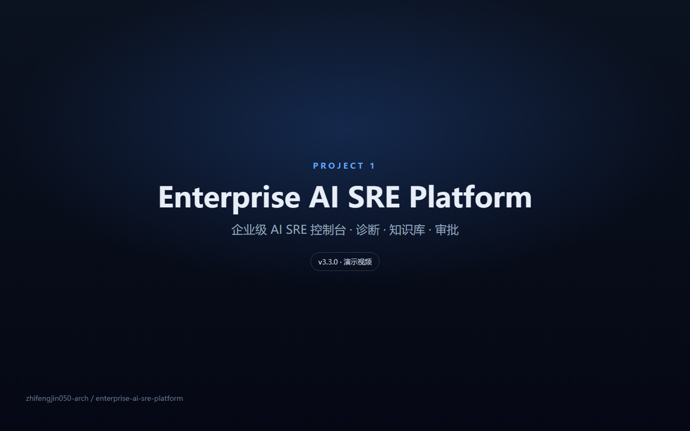
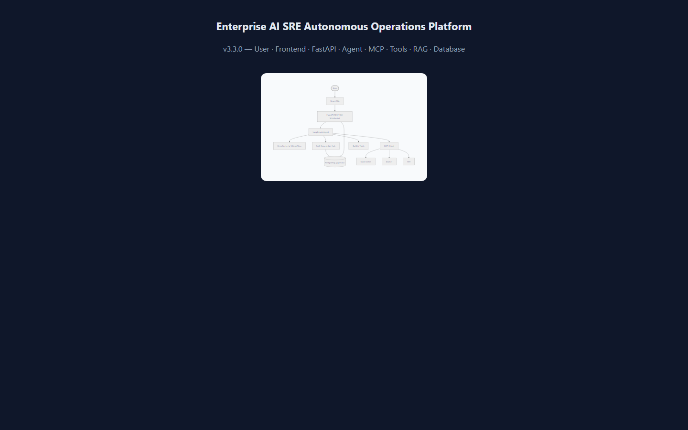
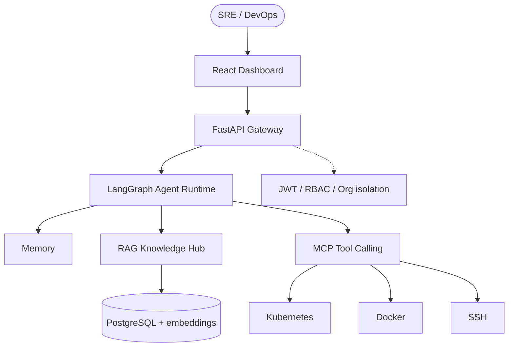
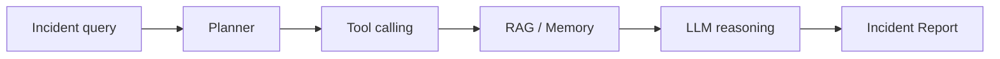
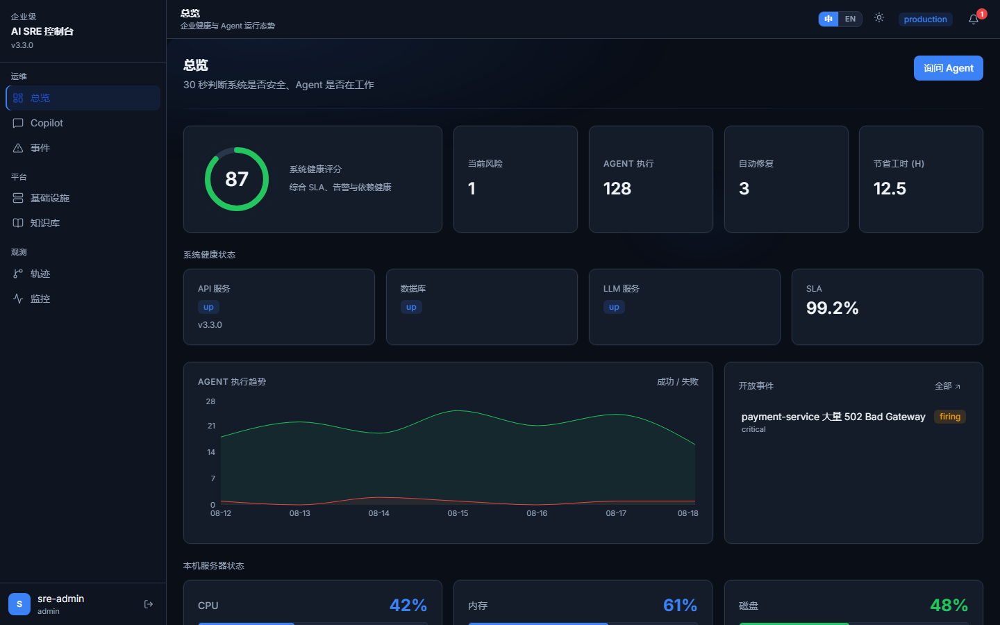
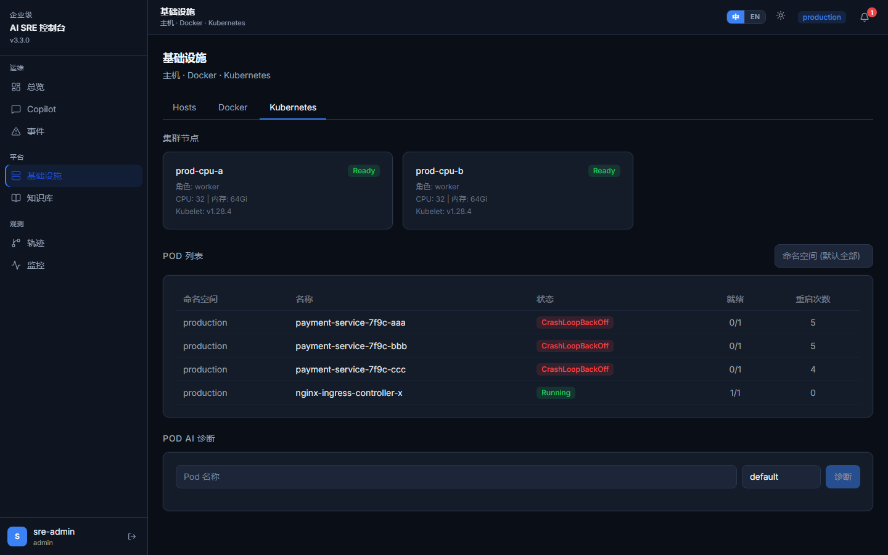

<div align="center">

# Enterprise AI DevOps Platform

**An enterprise SRE Agent platform: MCP tool calling, RAG knowledge hub, memory, and cloud-native diagnosis.**

Turn natural-language incidents into planned tool chains, retrieved runbooks, and structured incident reports.

[中文](README.md) · [Architecture](docs/ARCHITECTURE.md) · [Security](SECURITY.md) · [Contributing](CONTRIBUTING.md)

[]()
[]()
[]()
[]()
[]()
[](LICENSE)

</div>

---

## Positioning

Not a chatbot wrapper. An **enterprise operations product** for SRE and platform teams:

- **AI Agent** — LangGraph planner over live infrastructure evidence
- **MCP Tool Calling** — Kubernetes / Docker / SSH without rewriting the orchestrator
- **RAG Knowledge Hub** — multi-tenant runbooks and SOP retrieval
- **Memory** — working memory across a diagnosis session
- **Multi-tenant** — JWT, RBAC, organization isolation
- **Docker / Kubernetes** — Compose to run the platform; K8s as a diagnosis target

Repo: [enterprise-ai-sre-platform](https://github.com/zhifengjin050-arch/enterprise-ai-sre-platform)

---

## Demo

<video controls playsinline width="100%" poster="docs/videos/cover.png" preload="metadata">
  <source src="https://cdn.jsdelivr.net/gh/zhifengjin050-arch/enterprise-ai-sre-platform@main/docs/videos/demo.mp4" type="video/mp4" />
</video>

[](https://zhifengjin050-arch.github.io/enterprise-ai-sre-platform/)

Click the cover to watch the walkthrough (Chinese narration + subtitles). GitHub file pages do not play repo mp4s, so the player is hosted on GitHub Pages.

---

## Features

- Stateful Agent graph: `START → agent → tools → agent → END`
- MCP discovery for System / Docker / Kubernetes / SSH
- cosine RAG scoped by `organization_id`
- CrashLoopBackOff, OOMKilled, ImagePullBackOff, 502/503 playbooks
- Agent Trace + SSE live execution
- Incident reports with cited runbooks

---

## Architecture





### Agent workflow



---

## Use cases

| Scenario | Example |
|----------|---------|
| Production 502 | `payment-service is returning 502, find the root cause` |
| Pod crash | `CrashLoopBackOff in production namespace` |
| Capacity | `database connection pool is exhausted` |
| Fleet check | `inspect CPU and disk on managed hosts` |
| SOP lookup | `standard steps for OOMKilled` |

---

## Tech Stack

Python 3.12 · FastAPI · LangGraph · MCP · PostgreSQL · React 18 · Docker Compose · Prometheus / Grafana

---

## Screenshots

| Dashboard | Agent interaction |
|-----------|-------------------|
|  |  |

| Kubernetes | Architecture |
|------------|--------------|
|  |  |

---

## Quick Start

```bash
git clone https://github.com/zhifengjin050-arch/enterprise-ai-sre-platform.git
cd enterprise-ai-sre-platform
cp .env.example .env
docker compose up -d
```

Open http://localhost · `python demo/import_demo_data.py` for sample knowledge.

---

## Deployment

`docker compose up -d` is the supported path. See [docs/DEPLOYMENT.md](docs/DEPLOYMENT.md). Never commit a real `.env`.

---

## Roadmap

**v3.3.0 (current):** Agent, MCP, RAG, multi-tenant, Trace, SSE, Docker.

Later: multi-cloud intelligence, autonomous repair, larger MCP catalog.

---

## License

[MIT](LICENSE) · [CONTRIBUTING.md](CONTRIBUTING.md) · [CODE_OF_CONDUCT.md](CODE_OF_CONDUCT.md) · [SECURITY.md](SECURITY.md) · [CHANGELOG.md](CHANGELOG.md)
