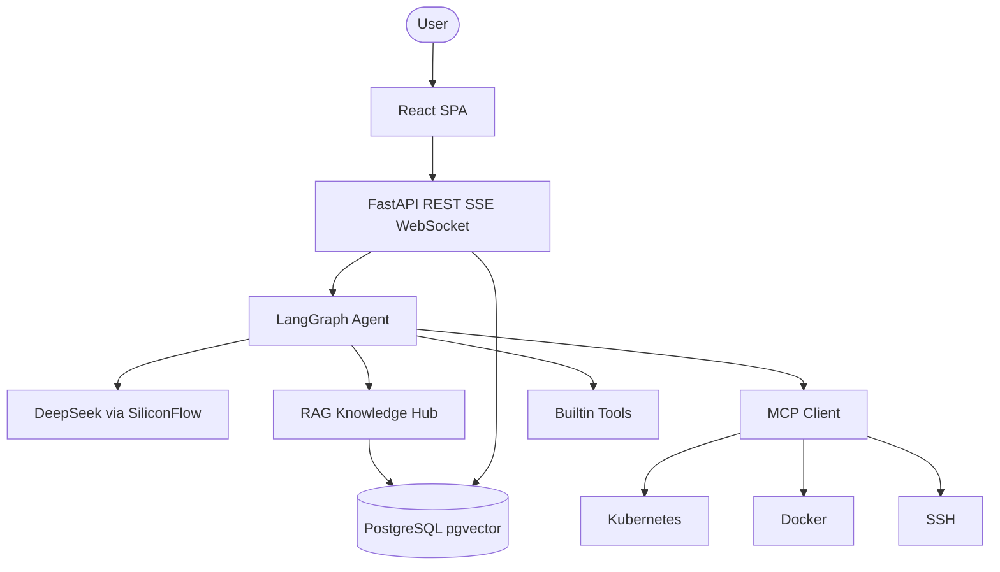
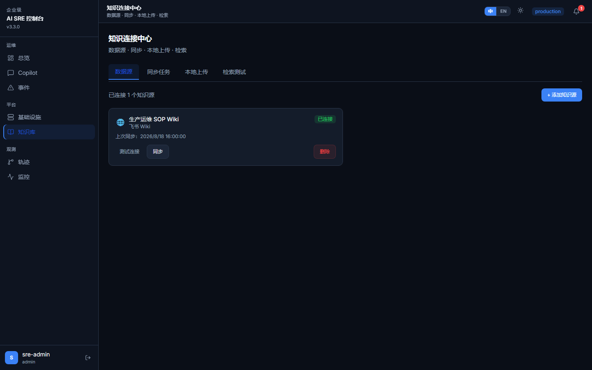
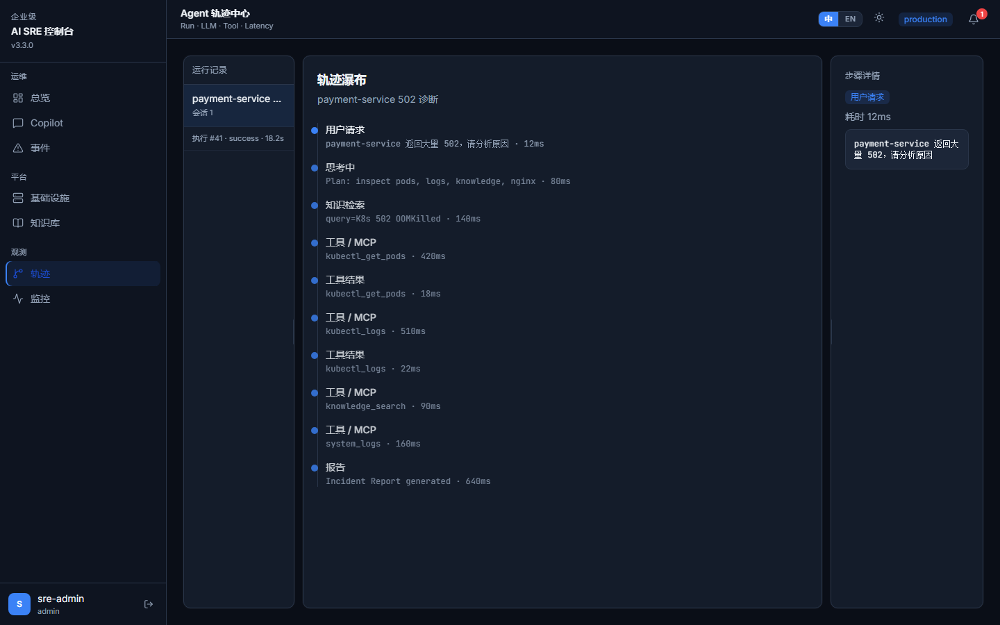
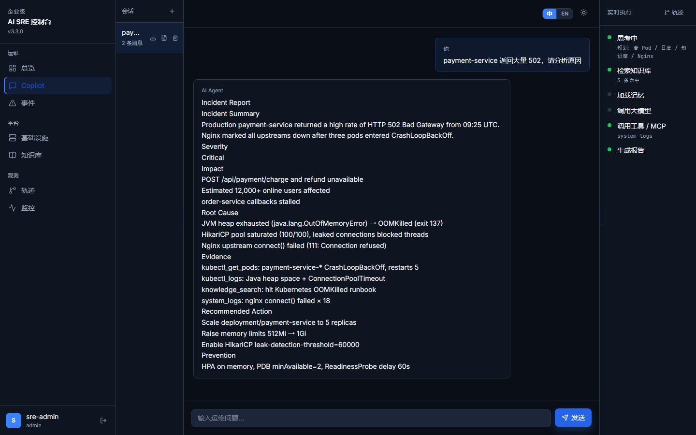

# Enterprise AI SRE Autonomous Operations Platform

<p align="center">
  
</p>

<p align="center">
  <b>Enterprise AI SRE Autonomous Operations Platform</b><br>
  An AI-powered SRE Agent platform built with LangGraph, MCP and RAG for autonomous infrastructure diagnosis.
</p>

<p align="center">
  <a href="README.md">简体中文</a> · <a href="README_EN.md">English</a>
</p>

<p align="center">
  
  
  
  
  
  
  
  
  
</p>

<p align="center">
  <a href="#overview">Overview</a> •
  <a href="#core-capabilities">Capabilities</a> •
  <a href="#architecture">Architecture</a> •
  <a href="#5-minute-demo">Demo</a> •
  <a href="#quick-start">Quick start</a> •
  <a href="#screenshots">Screenshots</a>
</p>

---

## Overview

An enterprise SRE / DevOps platform that turns natural language into infrastructure diagnosis. The Agent plans tool calls across Kubernetes, Docker and SSH, retrieves runbooks from a multi-tenant Knowledge Hub, and writes a structured incident report.

---

## Why AI SRE?

| Dimension | Traditional SRE | This platform |
|-----------|-----------------|---------------|
| Incident response | Alert → bastion → logs (30+ min) | Agent diagnosis in ~20 seconds |
| Tooling | Hand-written kubectl / SSH / Docker | Natural-language planned tool chains |
| Knowledge | Wikis and chat threads | RAG Knowledge Hub |
| Extensibility | Change Agent code for every tool | MCP discovery, no orchestrator rewrite |
| Observability | Split logs / metrics / traces | Agent Trace + SSE + Prometheus |
| Multi-tenancy | Incomplete RBAC | JWT + RBAC + organization isolation |

---

## Core capabilities

### AI SRE Agent

Stateful LangGraph graph: `START → agent → tools → agent → END`. The planner decomposes the incident; reasoning merges tool evidence and runbooks into RCA.

### LangGraph Workflow

The agent node injects RAG and memory, then calls the LLM. The tools node runs builtin and MCP tools in parallel and returns to the agent.

### MCP Tool Ecosystem

Model Context Protocol (stdio) discovers System, Docker, Kubernetes and SSH tools without per-tool Agent changes.

### RAG Knowledge Hub

Uploads, Feishu Wiki sync, and pgvector search. `knowledge_search` is scoped by `organization_id`.

### Kubernetes Diagnosis

CrashLoopBackOff, OOMKilled, ImagePullBackOff, Pending, and 502/503, using pod status, logs, and SOPs.

### Multi Tenant Architecture

Organization isolation, Admin / DevOps / Viewer roles, Fernet-encrypted connector credentials.

### Agent Trace

End-to-end spans for user input, RAG, LLM, and every tool call (args, output, latency) on a waterfall timeline.

### SSE Streaming

Server-Sent Events stream reasoning and tool progress to the Live Execution panel.

---

## Use cases

| Scenario | Example prompt |
|----------|----------------|
| Production 502 | `payment-service 返回大量 502，请分析原因` |
| Pod crash | Inspect CrashLoopBackOff in `production` |
| Connection pool | Diagnose exhausted DB pools |
| Health check | CPU and disk across managed hosts |
| SOP lookup | Standard steps for OOMKilled |

---

## Architecture



See [docs/ARCHITECTURE.md](docs/ARCHITECTURE.md) for the full design.

---

## Tech stack

| Layer | Stack |
|-------|--------|
| Agent | LangGraph + LangChain |
| LLM | DeepSeek-V4-Flash (SiliconFlow) |
| API | FastAPI + Uvicorn |
| Knowledge | RAG + pgvector + Feishu connector |
| Tools | MCP + kubectl / Docker / SSH |
| Frontend | React 18 + TypeScript + Vite + Tailwind CSS |
| Data | PostgreSQL 16 / SQLite (dev) |
| Observability | Agent Trace, SSE, Prometheus, Grafana |
| Deploy | Docker Compose |

---

## 5-minute Demo

Production Kubernetes: `payment-service` returning HTTP 502.

1. Sign in (`/login`).
2. Open Copilot (`/ops`) and enter:

```text
payment-service 返回大量 502，请分析原因
```

3. The Agent calls:

- `kubectl_get_pods`
- `kubectl_logs`
- `knowledge_search`
- `system_logs`

4. Output:

- Root Cause Analysis
- Incident Timeline
- Solution Recommendation

Load demo knowledge:

```bash
python demo/import_demo_data.py
```

Scenario files: [demo/](demo/) and [docs/DEMO_GUIDE.md](docs/DEMO_GUIDE.md).

---

## Screenshots

| Dashboard | Agent Chat |
|-----------|------------|
|  |  |

| Knowledge Hub | Trace Viewer |
|---------------|--------------|
|  |  |

| Kubernetes | Incident Report |
|------------|-----------------|
|  |  |


---

## Quick start

### Prerequisites

- Python 3.12+
- Node.js 18+ (local frontend)
- Docker (optional)
- [SiliconFlow](https://cloud.siliconflow.cn) API key

### Docker

```bash
git clone https://github.com/zhifengjin050-arch/enterprise-ai-sre-platform.git
cd enterprise-ai-sre-platform
cp .env.example .env
# Set SILICONFLOW_API_KEY in .env
docker compose up -d
```

Open http://localhost and register.

### Local development

**Backend**

```bash
pip install -r requirements.txt
cp .env.example .env
alembic upgrade head
uvicorn app.main:app --reload --host 127.0.0.1 --port 8000
```

**Frontend**

```bash
cd frontend
npm install
npm run dev
```

Dev UI: http://localhost:5173 (proxies `/api` to port `8000`).

### Console routes

| Route | Page |
|-------|------|
| `/overview` | Dashboard |
| `/ops` | AI SRE Copilot |
| `/infra` | Hosts / Docker / Kubernetes |
| `/knowledge` | Knowledge Hub |
| `/traces` | Agent Trace |
| `/incidents` | Incidents |
| `/monitor` | Monitoring |

---

## Roadmap

### v3.3.0 (current)

- [x] LangGraph Agent, MCP, RAG Knowledge Hub
- [x] Kubernetes diagnosis, multi-tenancy, Trace, SSE
- [x] Demo pack and open-source docs

### v3.4 (Planned)

- Multi Cloud Intelligence
- Autonomous Repair Workflow
- MCP Ecosystem

---

## Docs

- [Architecture](docs/ARCHITECTURE.md)
- [Demo guide](docs/DEMO_GUIDE.md)
- [Interview guide](docs/INTERVIEW_GUIDE.md)
- [Release notes](docs/V3.3_RELEASE_NOTES.md)
- [Contributing](CONTRIBUTING.md)
- [Security](SECURITY.md)
- [Changelog](CHANGELOG.md)

---

## GitHub

https://github.com/zhifengjin050-arch/enterprise-ai-sre-platform

---

## License

[MIT](LICENSE) © 2026 Enterprise AI SRE Platform
