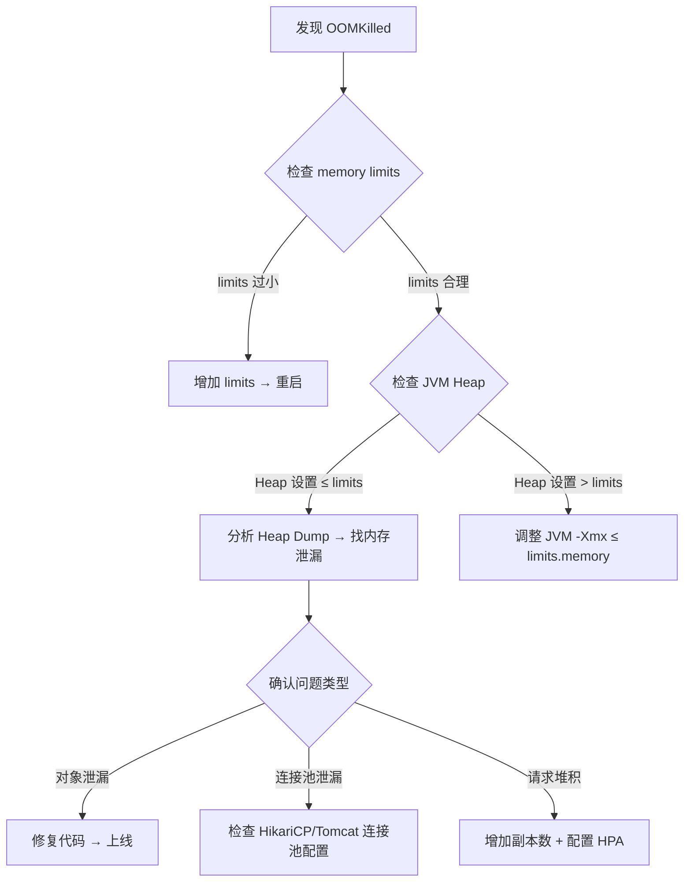

# Kubernetes 生产运维手册

> **版本**: v3.2.1 | **适用集群**: K8s v1.28+ | **最后更新**: 2026-08-01

---

## 第 1 章：Pod 启动失败诊断（标准 SOP）

### 1.1 CrashLoopBackOff

**定义**: Pod 反复崩溃重启，kubelet 指数退避（10s → 20s → 40s → 80s → 160s → 300s max）。

**标准排查流程 (SOP):**

```
Step 1: kubectl logs <pod-name> -n <namespace> --tail=100
  → 排查应用级错误（配置错误、依赖不可用、异常崩溃）

Step 2: kubectl describe pod <pod-name> -n <namespace>
  → 查看 Last State 的 exit code 和 Reason
  → exit code 137 = OOMKilled（内存超限）
  → exit code 1 = 应用错误
  → exit code 139 = Segfault

Step 3: kubectl get events -n <namespace> --sort-by='.lastTimestamp'
  → 查看集群事件时间线

Step 4: 检查 ConfigMap / Secret 挂载
  → kubectl get cm <name> -o yaml
  → kubectl get secret <name> -o yaml

Step 5: 检查资源限制
  → kubectl describe pod <pod-name> | grep -A5 Limits
```

**常见原因对照表:**

| 现象 | Exit Code | 可能原因 | 处理方案 |
|------|-----------|---------|---------|
| OOMKilled | 137 (SIGKILL) | 内存超 limit | 增加 resources.limits.memory |
| 应用初始化失败 | 1-10 | 配置错误 / 依赖未就绪 | 检查 ConfigMap / 依赖服务 |
| ImagePullBackOff | N/A | 镜像不存在 / 仓库认证失败 | 检查 imagePullSecrets |
| CrashLoopBackOff (无日志) | 0 或 137 | Readiness 探测失败 | 检查 probe 配置 |
| 健康检查失败 | N/A | Liveness 持续失败 | 检查 /health 端点 |

### 1.2 OOMKilled 深度排查

**现象**: Pod 反复重启，describe 显示 `Last State: Terminated, Reason: OOMKilled, Exit Code: 137`

**排查链路:**



**关键命令:**

```bash
# 检查 Pod 内存实际使用
kubectl top pod <pod-name> -n <namespace>

# 检查节点内存压力
kubectl top nodes
kubectl describe node <node-name> | grep -A10 "Allocated resources"

# 查看 OOM 详细事件
kubectl get events -n <namespace> --field-selector reason=OOMKilling
```

### 1.3 数据库连接池耗尽

**症状链:**
1. 应用日志出现 `ConnectionPoolTimeout: Timeout waiting for connection from pool`
2. 活跃连接数达到 `maximum-pool-size`
3. 请求响应时间飙升 → HTTP 502/503
4. Pod 内存持续上升（等待连接的请求堆积）

**标准排查 SOP:**

```bash
# Step 1: 确认连接池耗尽
kubectl logs <pod> -n <namespace> | grep -i "connectionpool\|hikari\|datasource"

# Step 2: 检查是否有连接泄漏
# 日志中出现 "Connection leak detection" 即为泄漏

# Step 3: 检查数据库侧连接数
# PostgreSQL:
#   SELECT count(*) FROM pg_stat_activity WHERE datname='devops_agent';

# Step 4: 临时恢复
kubectl delete pod <pod> -n <namespace>  # 强制重启释放连接
```

**配置建议:**

```yaml
# Spring Boot HikariCP — 生产推荐配置
spring.datasource.hikari.maximum-pool-size: 50    # 根据并发调整
spring.datasource.hikari.minimum-idle: 10          # 常驻连接
spring.datasource.hikari.connection-timeout: 30000  # 30s 获取超时
spring.datasource.hikari.idle-timeout: 300000       # 5min 空闲回收
spring.datasource.hikari.max-lifetime: 1800000      # 30min 最大存活
spring.datasource.hikari.leak-detection-threshold: 60000  # 60s 泄漏检测

# Tomcat JDBC Pool
spring.datasource.tomcat.max-active: 50
spring.datasource.tomcat.max-wait: 30000
spring.datasource.tomcat.remove-abandoned: true
spring.datasource.tomcat.remove-abandoned-timeout: 60
```

---

## 第 2 章：服务不可用诊断

### 2.1 502 Bad Gateway 排查

| 可能原因 | 排查工具 | 典型证据 |
|---------|---------|---------|
| Pod 未运行 | `kubectl get pods` | CrashLoopBackOff / OOMKilled |
| Service 端点异常 | `kubectl get endpoints` | 0 endpoints |
| Nginx upstream 故障 | 检查 Nginx error log | connect() failed (111) |
| 应用进程挂起 | `kubectl exec -- jstack` | 线程 BLOCKED / WAITING |

### 2.2 503 Service Unavailable

| 可能原因 | 排查工具 | 典型证据 |
|---------|---------|---------|
| HPA 缩容中 | `kubectl get hpa` | currentReplicas < desiredReplicas |
| 节点资源不足 | `kubectl top nodes` | CPU/Memory 接近 100% |
| PDB 阻止调度 | `kubectl describe pdb` | disruptionsAllowed = 0 |

### 2.3 诊断 Checklist

```bash
# □ 检查 Pod 状态
kubectl get pods -n production -o wide

# □ 检查 Service 和 Endpoints
kubectl get svc -n production
kubectl get endpoints -n production

# □ 检查 HPA 状态
kubectl get hpa -n production

# □ 检查集群事件
kubectl get events -n production --sort-by='.lastTimestamp'

# □ 检查节点资源
kubectl top nodes

# □ 检查 Pod 资源使用
kubectl top pods -n production
```

---

## 第 3 章：滚动更新与回滚

### 3.1 滚动更新策略

```yaml
apiVersion: apps/v1
kind: Deployment
metadata:
  name: payment-service
spec:
  replicas: 3
  strategy:
    type: RollingUpdate
    rollingUpdate:
      maxSurge: 1        # 最多比期望多 1 个 Pod
      maxUnavailable: 0  # 更新期间必须全部可用
  minReadySeconds: 30    # Pod 就绪后等待 30s 才算可用
```

### 3.2 回滚操作

```bash
# 查看历史版本
kubectl rollout history deployment/payment-service -n production

# 回滚到上一个版本
kubectl rollout undo deployment/payment-service -n production

# 回滚到指定版本
kubectl rollout undo deployment/payment-service -n production --to-revision=3

# 查看回滚状态
kubectl rollout status deployment/payment-service -n production
```

---

## 第 4 章：PodDisruptionBudget 配置

```yaml
apiVersion: policy/v1
kind: PodDisruptionBudget
metadata:
  name: payment-service-pdb
  namespace: production
spec:
  minAvailable: 2        # 至少 2 个 Pod 可用
  selector:
    matchLabels:
      app: payment-service
```

**用途:** 防止节点维护 / 集群升级时关键服务 Pod 全部被驱逐。

---

## 附录 A：快速参考命令

| 操作 | 命令 |
|------|------|
| 查看 Pod | `kubectl get pods -n <ns> -o wide` |
| 查看详情 | `kubectl describe pod <name> -n <ns>` |
| 查看日志 | `kubectl logs --tail=100 <name> -n <ns>` |
| 查看集群事件 | `kubectl get events -n <ns> --sort-by='.lastTimestamp'` |
| 查看资源使用 | `kubectl top pods -n <ns>` |
| 查看节点 | `kubectl top nodes` |
| 查看 HPA | `kubectl get hpa -n <ns>` |
| 查看 Endpoints | `kubectl get endpoints -n <ns>` |
| 回滚 | `kubectl rollout undo deployment/<name> -n <ns>` |
| 扩容 | `kubectl scale deployment/<name> -n <ns> --replicas=5` |