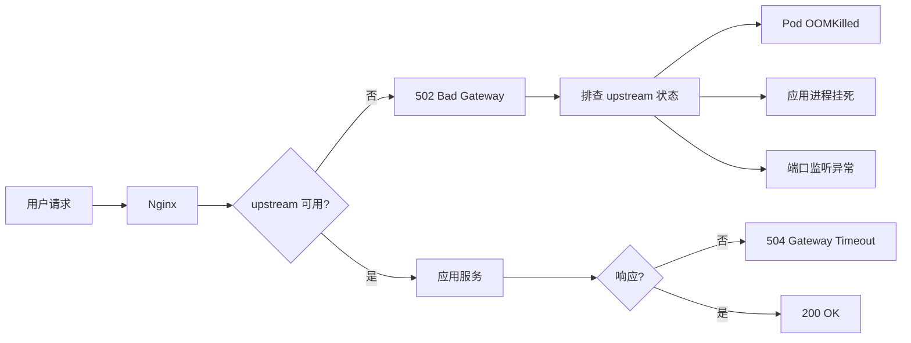

# Nginx 生产运维故障排查指南

> **版本**: v3.2.1 | **适用**: Nginx 1.24+ / OpenResty | **最后更新**: 2026-08-01

---

## 第 1 章：502 Bad Gateway 深度分析

### 1.1 根因链路



### 1.2 典型错误模式

#### 模式 A: `connect() failed (111: Connection refused)`

**含义:** Nginx 连接 upstream 时端口未监听或连接被拒绝。

**排查步骤:**
1. `kubectl get pods -n production | grep payment` — 确认 Pod 是否 Running
2. `kubectl exec <pod> -- netstat -tlnp | grep 8080` — 确认端口监听
3. `kubectl logs --tail=50 <pod> -n production` — 检查应用日志

**根因可能性:**
- Pod CrashLoopBackOff → upstream 端口不可用
- 应用启动慢 → ReadinessProbe 失败前流量已进入
- 进程挂死 → 端口监听存在但无响应

#### 模式 B: `no live upstreams while connecting to upstream`

**含义:** Nginx 健康检查标记所有 upstream 服务器为不可用。

**触发条件:**
- Upstream 连续返回 5xx 超过 `max_fails`（默认 1 次）
- 达到 `fail_timeout`（默认 10s）内全部标记为不可用

```nginx
# 健康检查配置示例
upstream payment_backend {
    server 10.96.0.50:8080 max_fails=3 fail_timeout=30s;
    server 10.96.0.51:8080 max_fails=3 fail_timeout=30s;
    server 10.96.0.52:8080 max_fails=3 fail_timeout=30s;

    keepalive 64;  # 连接池大小
}
```

#### 模式 C: `Connection reset by peer`

**含义:** Upstream 主动断开连接（通常表示进程崩溃或 OOMKilled）。

**排查:** `kubectl describe pod` → Last State: OOMKilled, Exit Code: 137

### 1.3 Nginx 配置最佳实践

```nginx
upstream payment_backend {
    least_conn;                              # 最少连接负载均衡
    keepalive 64;                            # 连接池
    keepalive_requests 1000;                 # 单连接最大请求数
    keepalive_timeout 60s;                   # 连接池超时

    server 10.96.0.50:8080 max_fails=3 fail_timeout=30s;
    server 10.96.0.51:8080 max_fails=3 fail_timeout=30s;
}

server {
    listen 80;
    server_name api.example.com;

    # 超时配置
    proxy_connect_timeout 5s;     # 连接 upstream 超时
    proxy_send_timeout 10s;       # 发送请求超时
    proxy_read_timeout 30s;       # 读取响应超时

    # 缓冲配置
    proxy_buffering on;
    proxy_buffer_size 4k;
    proxy_buffers 8 4k;

    # 错误处理
    proxy_next_upstream error timeout invalid_header http_502 http_503;
    proxy_next_upstream_tries 3;                # 最多尝试 3 个 upstream
    proxy_next_upstream_timeout 10s;           # 总重试超时

    location /api/payment/ {
        proxy_pass http://payment_backend;
        proxy_set_header Host $host;
        proxy_set_header X-Real-IP $remote_addr;

        # 状态码监控
        add_header X-Upstream-Status $upstream_status;
    }
}
```

---

## 第 2 章：Nginx 日志分析与监控

### 2.1 Error Log 解读

| 日志级别 | 含义 | 需要处理? |
|---------|------|----------|
| `[emerg]` | 紧急，进程无法启动 | ✅ 立即 |
| `[alert]` | 需要立即处理 | ✅ 立即 |
| `[crit]` | 临界条件 | ✅ 尽快 |
| `[error]` | 可恢复错误 | ⚠️ 需要关注 |
| `[warn]` | 潜在问题 | 👀 建议关注 |
| `[notice]` | 正常事件 | ℹ️ 无需处理 |

### 2.2 Access Log 关键指标

```json
{
  "remote_addr": "10.0.1.50",
  "request": "POST /api/payment/charge HTTP/1.1",
  "status": 502,
  "body_bytes_sent": 0,
  "request_time": 5.012,
  "upstream_addr": "10.96.0.50:8080",
  "upstream_status": "-",
  "upstream_response_time": "-",
  "upstream_connect_time": 5.001
}
```

**关键信号:**
- `upstream_status: "-"` — upstream 无响应（连接失败或超时）
- `upstream_connect_time > 3s` — 上游连接异常缓慢
- `request_time >> upstream_response_time` — Nginx 处理瓶颈

### 2.3 实时监控命令

```bash
# 实时查看 5xx 错误
tail -f /var/log/nginx/access.log | grep ' "5[0-9][0-9] '

# 统计 502 数量
grep ' 502 ' /var/log/nginx/access.log | wc -l

# 查看最近 error log
tail -50 /var/log/nginx/error.log

# 分析上游响应时间 (>3s 的慢请求)
awk '{if ($NF > 3) print}' /var/log/nginx/access.log | column -t
```

---

## 第 3 章：Upstream 连接池管理

### 3.1 连接池耗尽症状

| 指标 | 正常 | 警告 | 危险 |
|------|------|------|------|
| worker_connections | 768 | 4096 | 8192+ |
| 活跃连接数 | < 50% | 50-80% | > 80% |
| 连接超时率 | < 1% | 1-5% | > 5% |
| upstream 5xx 率 | < 1% | 1-5% | > 5% |

### 3.2 优化方案

```nginx
# 1. 增加 worker 数和连接数
worker_processes auto;
worker_rlimit_nofile 65535;

events {
    worker_connections 4096;
    multi_accept on;
    use epoll;
}

# 2. 启用 upstream keepalive
upstream backend {
    server 127.0.0.1:8080;
    keepalive 128;
    keepalive_requests 10000;
}

# 3. 系统级优化
# /etc/sysctl.conf
# net.core.somaxconn = 65535
# net.ipv4.tcp_max_syn_backlog = 65535
# net.ipv4.ip_local_port_range = 1024 65535
```