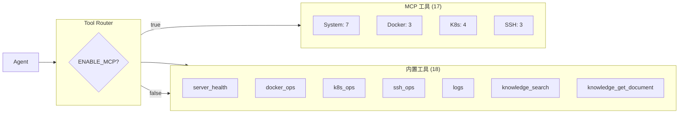
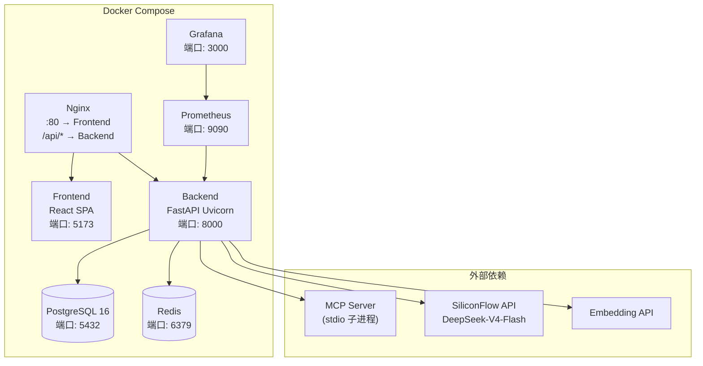

# Enterprise AI SRE Platform — 架构文档

> **版本**: v3.3.0  
> **更新日期**: 2026-08-18  
> **本文档面向**: 架构师 / 面试官 / 贡献者

---

## 1. 总体架构概览

### 1.1 架构分层图

```
┌─────────────────────────────────────────────────────────────┐
│                       用户层 (User Layer)                     │
│  Browser → React SPA (Vite + TypeScript + TailwindCSS)       │
└──────────────────────────┬──────────────────────────────────┘
                           │ HTTP / SSE / WebSocket
┌──────────────────────────▼──────────────────────────────────┐
│                     接入层 (API Layer)                        │
│  FastAPI + Uvicorn + CORS + Rate Limiting                    │
│  JWT Auth Middleware + RBAC Dependency                       │
│  Routes: /api/chat /api/knowledge /api/ops /api/auth ...     │
└──────────────────────────┬──────────────────────────────────┘
                           │
┌──────────────────────────▼──────────────────────────────────┐
│                   编排层 (Orchestration Layer)                 │
│  ┌─────────────────────────────────────────────────────┐    │
│  │              LangGraph Agent Engine                  │    │
│  │  StateGraph → Agent Node → Tools Node → Loop         │    │
│  │  + RAG Context Injection                             │    │
│  │  + Memory Context Injection                          │    │
│  │  + Tool Router (Internal + MCP)                      │    │
│  └─────────────────────────────────────────────────────┘    │
└───────┬─────────────┬──────────────┬────────────────────────┘
        │             │              │
┌───────▼──────┐ ┌────▼─────┐ ┌─────▼──────────────────────┐
│  推理层       │ │ 知识层    │ │   工具层                    │
│  LLM Engine  │ │ RAG + Hub│ │ ┌─────────────────────────┐│
│  DeepSeek    │ │ pgvector │ │ │ Tool Router             ││
│  Function    │ │ 文档上传  │ │ │ ├─ 内置 18 工具          ││
│  Calling     │ │ 飞书同步  │ │ │ ├─ MCP Client → 17 工具  ││
│  SiliconFlow │ │ 多租户   │ │ │ └─ 知识工具 2 个          ││
└──────────────┘ └──────────┘ │ └─────────────────────────┘│
                              └─────────────────────────────┘
```

### 1.2 核心设计原则

| 原则 | 说明 |
|------|------|
| **分层解耦** | Agent 编排、工具执行、知识检索、LLM 推理各层独立，可单独替换 |
| **协议标准化** | MCP 协议统一工具接口，任何 MCP Server 可动态接入 |
| **知识即服务** | RAG 知识库通过统一 Provider 对外提供服务，Agent 和 API 共享 |
| **安全内建** | JWT 认证、RBAC 授权、多租户隔离、敏感操作审批 |
| **可观测性** | Agent Trace 全链路记录 + Prometheus 指标 + Grafana 面板 |

---

## 2. Agent 引擎架构

### 2.1 LangGraph StateGraph

```
                    ┌──────────────┐
                    │  用户输入     │
                    └──────┬───────┘
                           ▼
                    ┌──────────────┐
                    │  Agent Node  │  ← RAG 上下文 + Memory 注入
                    │  LLM 推理    │  → Tool Calls 或 最终回答
                    └──────┬───────┘
                           ▼
                    ┌──────────────┐
                    │  Tools Node  │  并行执行工具
                    └──────┬───────┘
                           ▼
                    ┌──────────────┐
                    │  条件分支     │
                    └──────┬───────┘
                    工具调用│ │最终回答
                           │ ▼
                    ┌──────────────┐
                    │  输出报告     │
                    └──────────────┘
```

### 2.2 Agent 工具注册与路由



### 2.3 Agent 流执行引擎

Agent 支持两种输出模式：

| 模式 | 协议 | 特点 |
|------|------|------|
| **标准模式** | HTTP POST /api/chat | 阻塞等待完整结果 |
| **流式模式** | SSE /api/chat/stream | 实时推送推理步骤、工具调用、中间结果 |

SSE 事件类型：

| 事件 | 说明 |
|------|------|
| `on_tool_start` | 工具开始调用 |
| `on_tool_end` | 工具调用完成 |
| `on_agent_start` | Agent 开始推理 |
| `on_agent_end` | Agent 推理完成 |
| `on_message` | 文本块 |

---

## 3. 企业知识库 (v3.3)

### 3.1 架构

```
Enterprise Knowledge Hub v3.3
┌──────────────────────────────────────────────────────────────────┐
│                        API 层                                     │
│  /api/knowledge/* (CRUD + Search)                                 │
│  /api/knowledge-hub/* (Sources + Sync + Documents)                │
└──────────────────────────┬───────────────────────────────────────┘
                           │
┌──────────────────────────▼───────────────────────────────────────┐
│                     服务层 (Service Layer)                         │
│  ┌──────────────────────────────────────────────────────────┐    │
│  │  Document Provider (统一文档提供者)                         │    │
│  │  内部文档: rag_service.ingest_text                          │    │
│  │  Hub 文档: KnowledgeDocument → Chunk → Vector              │    │
│  │  Agent 工具: knowledge_search / knowledge_get_document      │    │
│  └──────────────────────────────────────────────────────────┘    │
│  ┌──────────────────────────────────────────────────────────┐    │
│  │  Knowledge Connector Pipeline                             │    │
│  │  Connector.list() → Connector.fetch() → parse → ingest    │    │
│  └──────────────────────────────────────────────────────────┘    │
│  ┌──────────────────────────────────────────────────────────┐    │
│  │  安全层                                                    │    │
│  │  RBAC: document_visible / source_manageable               │    │
│  │  Fernet 加密: 外部凭据加密存储                              │    │
│  └──────────────────────────────────────────────────────────┘    │
└──────────────┬───────────────────────────────┬──────────────────┘
               │                               │
┌──────────────▼──────────────┐  ┌─────────────▼────────────────┐
│       数据层                 │  │       外部连接器               │
│  KnowledgeDocument (表)     │  │  FeishuWikiConnector          │
│  KnowledgeChunk (表)        │  │  (可扩展: Confluence, Notion) │
│  KnowledgeSource (表)       │  │                               │
│  SyncTask / SyncLog (表)    │  │                               │
│  Document (现有)            │  │                               │
└─────────────────────────────┘  └──────────────────────────────┘
```

### 3.2 多租户隔离策略

```
Organization A                    Organization B
┌─────────────────────┐          ┌─────────────────────┐
│  User A1 (Admin)    │          │  User B1 (DevOps)   │
│  User A2 (DevOps)   │          │  User B2 (Viewer)   │
├─────────────────────┤          ├─────────────────────┤
│  KnowledgeSource A  │          │  KnowledgeSource B  │
│  Document A1        │          │  Document B1        │
│  Document A2        │          │  Document B2        │
│  SyncTask A         │          │  SyncTask B         │
└─────────────────────┘          └─────────────────────┘
         ✗                              ✗
   用户 B1 不可见                  用户 A1 不可见
```

---

## 4. 工具层架构

### 4.1 MCP 工具注册流程

```
┌──────────┐     ┌──────────┐     ┌──────────┐     ┌──────────┐
│  Agent   │────▶│ Tool     │────▶│ MCP      │────▶│ MCP      │
│  Node    │     │ Router   │     │ Client   │     │ Server   │
└──────────┘     └──────────┘     └──────────┘     └──────────┘
                      │
                      ├──▶ docker_list (内置)
                      ├──▶ k8s_get_pods (内置)
                      └──▶ k8s_get_pods (MCP, ENABLE_MCP=true)
```

当 `ENABLE_MCP=true` 时：
1. MCP Client 通过 stdio 启动子进程
2. 自动调用 `list_tools()` 发现工具列表
3. 将 MCP 工具与内置工具合并注册
4. 调用时通过 `call_tool()` 转发参数

### 4.2 工具分类

| 类别 | 数量 | 来源 | 示例 |
|------|:----:|------|------|
| 内置系统 | 4 | `app/tools/` | `server_health`, `system_logs` |
| 内置 Docker | 3 | `app/tools/` | `docker_list`, `docker_logs` |
| 内置 K8s | 4 | `app/tools/` | `k8s_get_pods`, `k8s_logs` |
| 内置 SSH | 3 | `app/tools/` | `ssh_execute`, `ssh_upload` |
| 内置知识 | 2 | `app/tools/` | `knowledge_search`, `knowledge_get_document` |
| 内置运维 | 2 | `app/tools/` | `incident_create`, `repair_approve` |
| MCP 系统 | 7 | MCP Server | `get_cpu_usage`, `get_memory_usage` |
| MCP Docker | 3 | MCP Server | `docker_list`, `docker_logs` |
| MCP K8s | 4 | MCP Server | `k8s_get_pods`, `k8s_logs` |
| MCP SSH | 3 | MCP Server | `ssh_check_connection`, `ssh_execute_command` |

---

## 5. 数据模型

### 5.1 核心数据库表

| 表 | 用途 | 归属 |
|----|------|------|
| `users` | 用户账号 + RBAC 角色 | v3.0 |
| `organizations` | 组织/租户 | v3.0 |
| `documents` | RAG 文档（手动上传） | v3.2 |
| `document_chunks` | 文档分块 + Embedding | v3.2 |
| `agent_executions` | Agent 执行记录 | v3.2 |
| `conversations` | 会话记录 | v3.2 |
| `knowledge_sources` | 知识源配置（外部连接器） | **v3.3** |
| `knowledge_documents` | Hub 文档（外部同步） | **v3.3** |
| `knowledge_chunks` | Hub 文档分块 + Embedding | **v3.3** |
| `sync_tasks` | 同步任务记录 | **v3.3** |
| `sync_logs` | 同步日志 | **v3.3** |

### 5.2 Embedding 与向量检索

- 来源: SiliconFlow / OpenAI 兼容 Embedding API
- 向量维度: 1024 (text-embedding-v3)
- 存储: pgvector 余弦相似度索引
- 业务隔离: organization_id + user_id 过滤

---

## 6. 安全架构

```
┌─────────────────────────────────────────────────────────────┐
│                     安全纵深防御体系                          │
├─────────────────────────────────────────────────────────────┤
│  1. 传输安全                                                │
│     - HTTPS 代理 (生产 Nginx)                                │
│     - CORS 白名单                                            │
│                                                             │
│  2. 认证 (Authentication)                                    │
│     - JWT (HS256, 生产 ≥32 字节密钥)                         │
│     - bcrypt 密码哈希                                        │
│     - 启动门禁: 生产环境拒绝弱 JWT                            │
│                                                             │
│  3. 授权 (Authorization)                                     │
│     - RBAC: Admin / DevOps / Viewer                          │
│     - 多租户: Organization 数据隔离                           │
│     - 资源级权限: 文档可见性 / 源可管理性                     │
│                                                             │
│  4. 工具安全                                                │
│     - Safe / Dangerous 操作分类                              │
│     - 危险操作需人工审批                                      │
│     - MCP Tool Metadata: risk_level / permission             │
│                                                             │
│  5. 数据安全                                                │
│     - 凭据加密存储 (Fernet)                                   │
│     - 日志脱敏 (SecretFilter)                                │
│     - .env gitignore                                          │
│                                                             │
│  6. 可观测安全                                              │
│     - 全链路 Agent Trace                                     │
│     - 审计日志                                                │
│     - Prometheus 告警                                        │
└─────────────────────────────────────────────────────────────┘
```

---

## 7. API 概览

### 7.1 核心端点

| 端点 | 方法 | 说明 | 认证 |
|------|------|------|------|
| `/api/auth/register` | POST | 注册 | 无 |
| `/api/auth/login` | POST | 登录 → JWT | 无 |
| `/api/chat` | POST | Agent 对话 | JWT |
| `/api/chat/stream` | POST | Agent SSE 流式对话 | JWT |
| `/api/knowledge/upload` | POST | 上传知识文档 | JWT |
| `/api/knowledge` | GET | 列出知识文档 | JWT |
| `/api/knowledge/search` | POST | 语义搜索 | JWT |
| `/api/knowledge-hub/sources` | CRUD | 知识源管理 | JWT + RBAC |
| `/api/knowledge-hub/documents` | GET | Hub 文档列表 | JWT |
| `/api/knowledge-hub/sync` | POST | 触发同步 | JWT + RBAC |
| `/api/ops/infra/*` | GET | 基础设施数据 | JWT |
| `/api/ops/incidents/*` | CRUD | 告警与故障 | JWT |
| `/api/ops/repair/*` | POST | 自动修复 | JWT + RBAC |
| `/api/traces` | GET | Agent Trace | JWT |
| `/api/agent/stats` | GET | Agent 统计 | JWT |
| `/health` | GET | 健康检查 | 无 |
| `/docs` | GET | Swagger 文档 | 无 |

### 7.2 SSE 事件流格式

```
event: on_agent_start
data: {"node":"agent","input":"生产环境 payment-service 出现 502"}

event: on_tool_start
data: {"tool":"k8s_get_pods","input":{"namespace":"production"}}

event: on_tool_end
data: {"tool":"k8s_get_pods","output":"[Pod payment-service-xxx: CrashLoopBackOff]"}

event: on_message
data: "## 故障分析报告\n\n### 问题摘要\n..."

event: on_agent_end
data: {"status":"success"}
```

---

## 8. 部署架构

### 8.1 Docker Compose 服务拓扑



### 8.2 环境配置

| 配置项 | 开发环境 | 生产环境 |
|--------|---------|---------|
| 数据库 | SQLite (本地) / PostgreSQL (Compose) | PostgreSQL 16 |
| JWT 密钥 | 任意 28+ 字符 | `openssl rand -hex 32` |
| LLM API | SiliconFlow 开发 Key | SiliconFlow 生产 Key |
| CORS | `*` | 白名单域名 |
| 日志级别 | DEBUG | INFO |
| MCP Server | 本地路径 | 容器内路径 |

---

## 9. 项目文件统计

| 目录 | 文件数 | 说明 |
|------|:------:|------|
| `app/` | ~50 | Python 后端 |
| `frontend/src/` | ~40 | React + TypeScript |
| `tests/` | ~16 | 测试文件 (280+ 用例) |
| `docs/` | ~20 | 项目文档 |
| `demo/` | 8 | Demo 数据 |
| `scripts/` | ~10 | 工具脚本 |
| `alembic/` | ~6 | 数据库迁移 |
| `prometheus/` | 3 | Prometheus 配置 |
| `grafana/` | 3 | Grafana 仪表盘 |

---

> **文档版本**: v3.3.0 | **更新日期**: 2026-08-18 | **返回**: [README](../README.md)