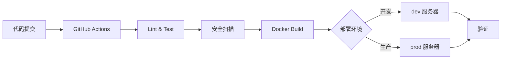

# 部署文档

> Enterprise AI DevOps Agent — 生产部署指南

---

## 目录

1. [本地开发部署](#1-本地开发部署)
2. [Linux 服务器部署](#2-linux-服务器部署)
3. [生产环境部署](#3-生产环境部署)
4. [CI/CD 流程](#4-cicd-流程)
5. [运维指南](#5-运维指南)
6. [故障排查](#6-故障排查)

---

## 1. 本地开发部署

### 前置要求

- Docker 24+ & Docker Compose v2
- Python 3.12+（如果本地运行后端）
- Node.js 20+（如果本地运行前端）

### 快速启动（推荐）

```bash
# 1. 克隆项目
git clone https://github.com/your-org/ai-devops-assistant.git
cd ai-devops-assistant

# 2. 配置环境变量
cp .env.example .env
# 编辑 .env 填入 DEEPSEEK_API_KEY

# 3. 启动所有服务
docker compose up -d

# 4. 检查健康状态
curl http://localhost:8000/health

# 5. 访问 Web 控制台
open http://localhost
```

### 本地开发（前后端分离）

```bash
# 终端 1：启动数据库和基础设施
docker compose up -d postgres prometheus

# 终端 2：启动后端
python -m venv .venv
.venv\Scripts\activate  # Windows
# source .venv/bin/activate  # Linux/Mac
pip install -r requirements.txt
uvicorn app.main:app --reload --port 8000

# 终端 3：启动前端
cd frontend
npm install
npm run dev
```

---

## 2. Linux 服务器部署

### 安装 Docker

```bash
# Ubuntu / Debian
curl -fsSL https://get.docker.com | bash
sudo usermod -aG docker $USER

# 验证
docker --version
docker compose version
```

### 一键部署脚本

项目提供 `scripts/deploy.sh` 部署脚本：

```bash
# 确保脚本可执行
chmod +x scripts/deploy.sh

# 运行部署
./scripts/deploy.sh
```

### 手动部署

```bash
# 1. 克隆项目
git clone https://github.com/your-org/ai-devops-assistant.git
cd ai-devops-assistant

# 2. 配置生产环境变量
cp .env.production.example .env.production
# 编辑 .env.production，修改以下配置：
#   - DEEPSEEK_API_KEY
#   - JWT_SECRET（使用 openssl rand -hex 32 生成）
#   - POSTGRES_PASSWORD
#   - CORS_ORIGINS
#   - GRAFANA_ADMIN_PASSWORD

# 3. 生成 SSL 证书（如果有域名）
sudo certbot certonly --standalone -d your-domain.com
sudo cp /etc/letsencrypt/live/your-domain.com/fullchain.pem ssl/
sudo cp /etc/letsencrypt/live/your-domain.com/privkey.pem ssl/
sudo chmod 600 ssl/privkey.pem

# 4. 启动生产环境
docker compose -f docker-compose.prod.yml up -d

# 5. 验证服务
curl http://localhost:8000/health
curl https://your-domain.com/
```

---

## 3. 生产环境部署

### 架构图

```
┌─────────────┐     ┌─────────────┐     ┌─────────────┐
│   Browser   │────▶│   Nginx     │────▶│   Backend   │
│  (HTTPS)    │     │  (SSL Term) │     │  (FastAPI)  │
└─────────────┘     └──────┬──────┘     └──────┬──────┘
                           │                   │
                           │            ┌──────▼──────┐
                           │            │  PostgreSQL  │
                           │            └──────────────┘
                    ┌──────▼──────┐
                    │  Prometheus │───▶ Grafana
                    └─────────────┘
```

### 环境要求

| 组件 | 最低配置 | 推荐配置 |
|------|---------|---------|
| CPU | 2 核 | 4 核 |
| 内存 | 4 GB | 8 GB |
| 磁盘 | 20 GB | 50 GB (SSD) |
| Docker | 24+ | 最新稳定版 |
| 域名 | 可选 | 建议配置 |

### docker-compose.prod.yml 说明

```bash
# 生产环境启动
docker compose -f docker-compose.prod.yml up -d

# 停止生产环境
docker compose -f docker-compose.prod.yml down

# 查看日志
docker compose -f docker-compose.prod.yml logs -f backend
docker compose -f docker-compose.prod.yml logs -f frontend
```

生产配置与开发配置的区别：

| 配置项 | 开发环境 | 生产环境 |
|--------|---------|---------|
| 端口暴露 | 全端口 | 127.0.0.1 限制 |
| 资源限制 | 无 | CPU/内存限制 |
| 日志 | 控制台 | json-file + 轮转 |
| 数据库端口 | 5432 暴露 | 仅内部访问 |
| SSL 证书 | 无 | 需要配置 |
| 重启策略 | unless-stopped | unless-stopped |
| 认证配置 | 宽松 | 严格 |

### CI/CD 部署流水线



---

## 4. CI/CD 流程

### GitHub Actions

项目配置了两个 Workflow：

**1. CI Pipeline** (`.github/workflows/ci.yml`)

```
触发条件: push/PR 到 main 分支
作业:
  ├── Backend: Lint (ruff) → Type Check (mypy) → Test (pytest)
  ├── Frontend: Lint → Test (vitest) → Build
  └── Docker: Build 验证
```

**2. Security Scan** (`.github/workflows/security.yml`)

```
触发条件: 定时 (每周) / 手动 / 依赖变更
作业:
  ├── pip-audit: Python 依赖 CVE 扫描
  ├── Trivy: Docker 镜像漏洞扫描
  └── Gitleaks: Secret 泄露检测
```

### 手动触发部署

```bash
# 使用 gh CLI 触发安全扫描
gh workflow run security.yml

# 查看 workflow 状态
gh run list --workflow=ci.yml
```

---

## 5. 运维指南

### 健康检查

```bash
# 后端健康
curl http://localhost:8000/health

# 预期输出:
# {"status":"healthy","version":"v1.2.0","services":{"api":"ok","database":"ok","llm":"ok","monitoring":"inactive"}}

# Prometheus
curl http://localhost:9090/-/ready

# Grafana
curl http://localhost:3000/api/health
```

### 日志查看

```bash
# 后端日志
docker compose logs -f --tail=100 backend

# 数据库日志
docker compose logs -f --tail=50 postgres

# 前端日志
docker compose logs -f --tail=50 frontend
```

### 数据备份

```bash
# PostgreSQL 备份
docker compose exec postgres pg_dump -U devops devops_agent > backup_$(date +%Y%m%d).sql

# 恢复
cat backup.sql | docker compose exec -T postgres psql -U devops devops_agent
```

### 升级流程

```bash
# 1. 拉取最新代码
git pull origin main

# 2. 重新构建并启动
docker compose -f docker-compose.prod.yml build
docker compose -f docker-compose.prod.yml up -d

# 3. 执行数据库迁移
docker compose exec backend alembic upgrade head

# 4. 验证升级
curl http://localhost:8000/health
```

---

## 6. 故障排查

### 常见问题

| 问题 | 原因 | 解决 |
|------|------|------|
| 后端 503 | 数据库未就绪 | 等待 PostgreSQL 健康检查通过 |
| API 返回 401 | Token 过期 | 重新登录获取新 Token |
| Agent 不响应 | LLM API Key 无效 | 检查 `.env` 中 `DEEPSEEK_API_KEY` |
| WebSocket 断连 | 反向代理超时 | Nginx `proxy_read_timeout` 设为 3600s |
| Docker 构建慢 | 无缓存 | 使用 `docker compose build --no-cache` |
| 端口冲突 | 端口被占用 | 修改 `docker-compose.yml` 端口映射 |

### 健康检查矩阵

```bash
# 一键健康检查脚本
echo "=== 服务健康状态 ==="
for service in backend frontend postgres prometheus grafana; do
  status=$(docker compose ps --format json $service | python -c "import sys,json; print(json.load(sys.stdin).get('Health','unknown'))" 2>/dev/null || echo "unknown")
  echo "  $service: $status"
done
```